# Loy Krathong look v2 — art direction (MFW-47, backlog 9.1)

Every value here mirrors `src/config/look.config.ts`; config wins.

Owner decisions: open question 27 (visual target) and open question 32 (day / night), both 2026-11-25.

## 1. Visual target

The target is `docs/spec/assets/loy-krathong-look-ref.png`.

The image is a 3/4 isometric, toy/clay diorama in soft overcast daylight. It shows pale sage land, a calm blue-grey
river, cream houses with a muted teal roof and a terracotta roof, round blob trees on short brown trunks, a light
wooden pier, and a green banana-leaf krathong with coral/cream flowers and a glowing candle. Every edge is rounded.
Nothing is glossy, and no pixel is near-black. Shadows are soft, low-contrast, green/blue-grey blobs under trees,
houses and the krathong, with no hard edges. The light comes from the upper left and the fill is strong and even:
the shadow side of a house is only about 35 % darker than its lit side.

## 2. Palette (`LOOK_PALETTE`)

Sampled from the reference image (median colour per region). All values are DRAFT until the owner signs off on the
screenshots. "Reserved" keys are not used yet; the listed card builds on them.

| Key | Hex | Use |
|---|---|---|
| grass | #A7BA96 | lit land (banks) |
| grassShade | #5E6D54 | land in contact shade under trees — reserved for 9.3 |
| water | #90AAAE | river body |
| waterLight | #ACC3C7 | river highlight near the bank — used since MFW-49 (shore band, glints, krathong ripples) |
| waterDeep | #546970 | water in shade by the bank / under the pier — used since MFW-49 (window glass) |
| wallCream | #E4D4B3 | house walls |
| roofTeal | #718C86 | pyramid house roofs |
| roofTerracotta | #D1936B | gable house roofs — used since MFW-49 |
| doorWood | #B9815A | house doors — used since MFW-49; krathong incense sticks (MFW-48) |
| woodLight | #D4AE82 | pier deck |
| woodDark | #725F46 | pier posts, lamp posts |
| trunk | #7C5D40 | tree trunks |
| canopy | #8CA682 | tree canopies |
| canopyShade | #4E644E | canopy shade side — reserved for 9.3 |
| leafLight | #8DA667 | krathong banana leaf, lit — banana-trunk base (MFW-48) |
| leafDark | #3F5B35 | krathong banana leaf, shade — reserved for 9.2 |
| flowerCoral | #E19A7C | krathong flower petals — reserved for 9.2 |
| flowerCream | #EBDFC4 | pale krathong petals — reserved for 9.2 |
| flowerYellow | #F2D585 | flower centres (krathong, MFW-48), lamp heads |
| candleWax | #D5B279 | candle body — reserved for 9.2 |
| flameCore | #FDF7C6 | flame core — krathong flame albedo (MFW-48) |
| flameHalo | #F9EAA6 | flame halo — reserved for 9.2 |
| lanternGlow | #FFC46B | warm lamp emissive |
| shadowTint | #40564A | blob-shadow tint (dark sage, never black) |
| daySky | #D8E4CF | DAY background (pale sage haze); also the 2D fallback background |
| nightSky | #2E3E63 | NIGHT background (deep periwinkle, not black) |
| stone | #B9B7A8 | riverside rocks; not in the reference, DRAFT (MFW-49) |

## 3. Material rules

- Matte only: roughness 1, metalness 0 (the `MatteMaterialSpec` literal types enforce it).
- Curved parts are smooth-shaded (`flatShading: false`): rounded house bodies, cylinders (trunks, posts, piles),
  icosahedron canopies (detail 1) and the small lamp heads. Planar pyramids (roofs) stay flat-shaded.
  - Instanced parts share one shader program: a flat-shaded part spec gets its flatness baked into per-face normals
    (`createInstancedPartGeometry`) and a smooth-shaded material. It looks the same and avoids a second program compile.
  - Banks (flat ribbons with up normals) and the deck (a box) use `flatShading: false`. They look the same and share
    the water / krathong program.
- House bodies are bevelled: `roundedBox` with radius 0.06 and 1 bevel segment (108 triangles), smooth-shaded so the
  edge reads rounded. The lead's draft had 2 segments (300 triangles); at the scene's size the two look the same, and
  the extra triangles cost frame time in the SwiftShader e2e (see §7). The per-part low-poly guard
  `ENVIRONMENT_PART_MAX_TRIANGLES` is 128 (largest part 108).
- Lamp heads stay icosahedron detail 0 (about 7 px on screen), smooth-shaded.
- Pastel: no environment albedo below `LOOK_MIN_ALBEDO_LUMINANCE` = 0.1 (WCAG relative luminance).
- No black shadows: the key-light shadow has `shadow.intensity` < 1, and blob shadows are a translucent sage tint.
- Readability guard (AC3): the estimated lit luminance (`estimateLitLuminance`, linear Lambert before tone mapping)
  of every environment surface, up-facing and camera-facing side, is ≥ `LOOK_MIN_LIT_LUMINANCE` = 0.025 in both
  presets. The MFW-27 night look scored ≤ 0.014 and fails it.

## 4. Light presets (`LIGHT_PRESETS`)

Renderer: Neutral tone mapping (`LOOK_RENDERER`, exposure 1). It keeps the pastel albedo close to the sampled hexes;
R3F's default ACES darkens and shifts them. All lights are world-fixed (outside the pan/rotate group).

| Field | DAY | NIGHT |
|---|---|---|
| background | #D8E4CF (daySky) | #2E3E63 (nightSky) |
| hemisphere sky / ground / intensity | #EEF2EC / #A7BA96 / 1.6 | #A9B9E6 / #5B6A86 / 1.7 |
| ambient colour / intensity | #FFFFFF / 0.4 | #8FA2D6 / 0.5 |
| key (sun / moon) colour / intensity / position | #FFF4E3 / 2.4 / [-5, 6.5, 5] | #CAD7FF / 1.3 / [-4, 7, 3] |
| key shadow intensity / radius / bias / normalBias | 0.5 / 5 / -0.0005 / 0.02 | 0.4 / 5 / -0.0005 / 0.02 |
| candle point light scale | 0.15 | 1 |
| flame emissive intensity | 2.2 | 3.0 |

DAY was tuned from the lead's draft on the screenshots: a cooler sky fill (#F6F2E6 → #EEF2EC) and a less orange
sun (#FFF0D9 → #FFF4E3) keep the river blue-grey, and a lower sun ([-5, 8, 4] → [-5, 6.5, 5]) lights the cream walls
as in the reference instead of only the ground.

Candle and flame:

- The own-krathong candle point light is `TOY_SCENE_LIGHTING.candle` (#ffb35c, 14, distance 7) × the preset's
  `candle.intensityScale`. The scale is applied through a spring interpolation, so a preset switch never restarts a
  release.
- The shared krathong flame material is not tone-mapped (`KRATHONG_FLAME_GLOW`), and its emissive intensity is set
  per preset. That makes the flame the brightest surface in both presets without a bloom pass (guarded in
  `riverLayout.test.ts`).
- Lamp heads are pale yellow with a small warm emissive (lanternGlow, 0.35). Per-preset lamps and lit windows are 9.3.

A preset change is an instant cut (no cross-fade), so it is safe under reduced motion by construction.

## 5. Shadows

- HIGH: the tier's key-light shadow map (`MOON_SHADOW_MAP_SIZE_PX`, clamped to the tier texture size). three 0.187
  maps R3F's soft type to PCF, which honours `shadow.radius` 5; `shadow.intensity` 0.4–0.5 under a strong hemisphere
  fill keeps shadows soft and never black. Plus the blob shadows below.
- MEDIUM / LOW: no shadow map (tier budget); blob shadows only.
- Blob shadows on every 3D tier: vertex-alpha fans (`buildBlobShadowFan`, no texture), alpha 1 at the centre falling to
  0 at the rim (`falloffExponent` 1.6), tint `shadowTint` at opacity 0.35, lifted 0.006 above the surface with a
  polygon offset.
  - Fan resolution (`BLOB_SHADOW_TIER_GEOMETRY`, segments × rings): HIGH 16×2 (48 triangles), MEDIUM 12×2 (36),
    LOW 10×2 (30, the cheap variant). The lead's draft had HIGH 24×3 and MEDIUM 16×3; lowered for the same e2e frame
    budget, with no visible difference.
  - Radii (`RIVER_ENVIRONMENT_BLOB_SHADOWS`, local units × instance scale): houses 0.56 × 0.44, trees 0.42, lamps 0.1.
  - Own krathong: `KRATHONG_BLOB_SHADOW` radius 1.45 model units at the water line. River krathongs:
    `RIVER_KRATHONG_BLOB_SHADOW_RADIUS` = 1.45 × `RIVER_KRATHONG_SCALE` world units, moved per frame with the krathong.
  - Three draw calls in total (environment, river and own-krathong InstancedMeshes; the own-krathong one holds a single
    instance so it shares the blob program), whatever the number of krathongs.
  - Blobs ignore raycasts (`NO_RAYCAST`), so they never steal a tap from the water, props or krathongs.

## 6. Time of day and the switch

- AUTO (default) follows the device's local clock: DAY from 06:00 to 18:00, NIGHT otherwise (`DAY_NIGHT_HOURS`,
  PLACEHOLDER). One timer fires at the next boundary, and the clock is re-read when the tab becomes visible again.
  There is no per-frame or per-second work.
- The switch below the scene ("แสงในฉาก": ตามเวลาจริง / กลางวัน / กลางคืน) overrides AUTO. It is hidden before profiling
  and on FALLBACK_2D (the 2D view keeps the DAY albedo until MFW-51).
- The choice is a per-device display preference. It is kept only in this device's LocalStorage under
  `mfw:lightPreset:v1` ("DAY" or "NIGHT"; AUTO = no key) and in `useDeviceStore.lightPresetChoice`. It is never sent
  to the server and is not creation data.
- SSR snapshot: NIGHT (`LIGHT_PRESET_SERVER_FALLBACK`); the scene never renders on the server.

## 7. Tiers and performance

- The per-tier budgets in `performance.config.ts` are unchanged. Every environment part stays one InstancedMesh, so
  the rounded shapes add triangles but no draw calls.
- e2e `perf-audit.spec.ts` numbers (SwiftShader, local container), before (BASE fe5c4bf) → after (MFW-47):
  - "Draw calls do not grow" (ran at MEDIUM both times): 17 → 19 draw calls with one or a full zone of river
    krathongs; triangles 1 440 → 3 416 (one krathong) and 19 300 → 22 968 (full zone).
  - LOW zone switches: 17 → 19 draw calls, flat across 20 switches; geometries 18 → 21, flat; programs 8 → 8.
  - Probe soak (80 river krathongs): 28 → 30 draw calls, 23 168 → 26 134 triangles, geometries 23 → 26, programs
    8 → 8; every counter flat across 20 zone switches.
  - Draw calls do not grow with the number of river krathongs, before or after.
  - Measured +2 calls (environment and river blobs). The own-krathong blob adds a third call whenever the own krathong is
    drawn; the audited WORLD_EXPLORE views do not draw it.
- SwiftShader frame budget: the e2e profiler drops a 3D tier to FALLBACK_2D below 20 FPS. SwiftShader renders and
  compiles shaders on the CPU, so triangles and shader programs cost real frame time there; a tier step-down
  re-creates the canvas and recompiles every program.
  - The lead's draft had about 2.8× BASE's triangles in the HIGH world view (11 592 against 4 200) and 12 programs
    against 8, and the HIGH e2e specs fell back to 2D under load more often than BASE.
  - With 1-segment house bevels, detail-0 lamp heads, lighter blob fans, a one-instance krathong blob and shared
    instanced / planar programs it has 7 488 triangles and 8 programs, the same program count as BASE.
  - Real phone GPUs are far from this limit; the on-device check is in `docs/follow-ups.md`.
- Reduced motion: nothing in the look animates (lights, blobs, preset change), so the output is identical with
  reduced motion on.

## 8. What 9.2–9.5 build on

- 9.2 (MFW-48, krathong models): leafLight, leafDark, flowerCoral, flowerCream, flowerYellow, candleWax, flameCore,
  flameHalo; the flame-glow rule; `KRATHONG_BLOB_SHADOW`.
- 9.3 (MFW-49, river and environment): waterLight, waterDeep, roofTerracotta, doorWood (used, §11); per-preset lamps,
  lit windows, wider water. grassShade and canopyShade stay unused (the lit matte program shades them).
- 9.4 (MFW-50, villagers): the palette and the blob-shadow helpers (`DynamicBlobShadows`).
- 9.5 (MFW-51, 2D): the same palette; a 2D day/night preset and switch.

## 9. DRAFT / PLACEHOLDER values

- DRAFT: every `LOOK_PALETTE` hex; every `LIGHT_PRESETS` value; `LOOK_RENDERER`; `BLOB_SHADOW_LOOK`;
  `BLOB_SHADOW_TIER_GEOMETRY`; `KRATHONG_BLOB_SHADOW`; `RIVER_ENVIRONMENT_BLOB_SHADOWS`; the switch copy and its visual
  design; the instant-cut preset change.
- PLACEHOLDER: `DAY_NIGHT_HOURS` (06:00–18:00).
- Lead guards (not product numbers): `LOOK_MIN_LIT_LUMINANCE` 0.025, `LOOK_MIN_ALBEDO_LUMINANCE` 0.1,
  `ENVIRONMENT_PART_MAX_TRIANGLES` 128.

## Before / after (MFW-47)

Captured on the production build with SwiftShader WebGL (HIGH tier, before the full-screen stage of MFW-54).

| | Before (night only) | After — day | After — night |
|---|---|---|---|
| World, 1440×900 | 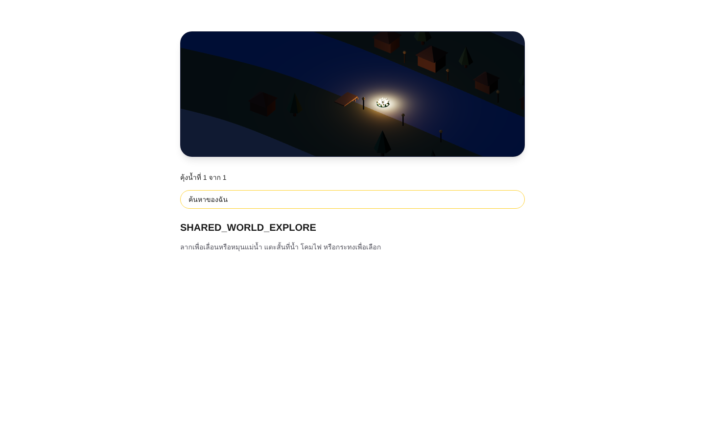 |  | 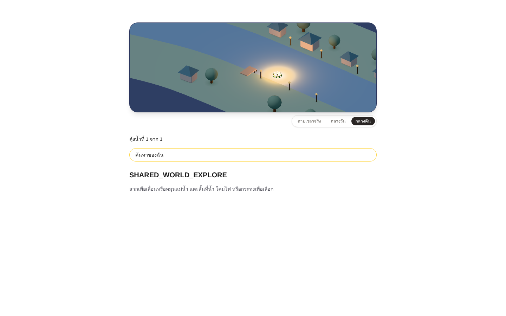 |
| Customize, 390×844 | 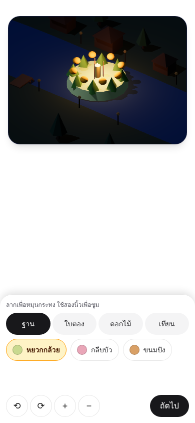 | 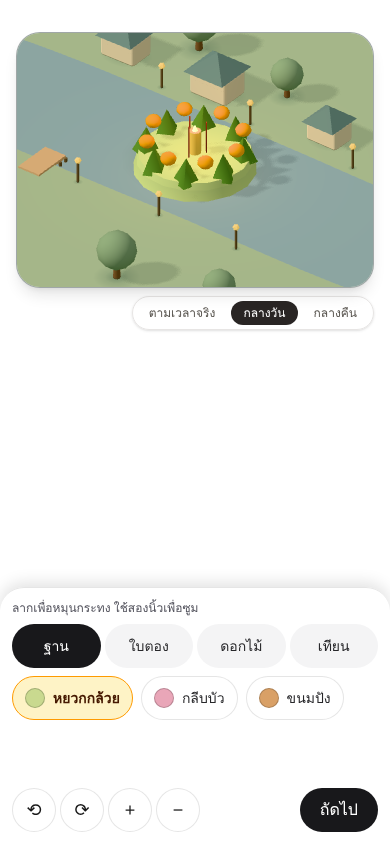 | — |

## 10. Krathong v2 (MFW-48)

Backlog 9.2. Every value mirrors `src/config/krathongModel.config.ts` (config wins) and is **DRAFT**: the owner reviews it
from the screenshots below. Appearance keys and stored appearance data are unchanged, so saved krathongs render with v2.
The same model is drawn in the customizer, at the pier and on the river; the river uses the instanced batch.

### Shapes

All parts are parametric clay meshes. Each is an indexed closed solid with smooth normals, built by
`src/core/customization/krathongMeshData.ts`.
- Bases:
  - banana trunk: a puffy rounded drum (lathe);
  - lotus: two layers of rounded petal lobes;
  - bread: a rounded dome.
  Leaves and flowers sit on each base's `rimY`.
- Leaves: 8 units, each with two folded blades (a diamond cross-section gives the centre ridge).
  - A shorter outer blade flares out with its tip curled up.
  - A taller inner blade stands almost upright on the flower-socket angle.
  - style_01 is pointed, style_02 is broader and rounder.
  - A fixed per-leaf yaw / scale jitter (`KRATHONG_LEAF_VARIATION`) makes the ring look hand-made.
- Flowers face up and outward (`KRATHONG_FLOWER_TILT_RAD`), each with a round centre part:
  - marigold: two star-petal layers;
  - orchid: 5 rounded petals;
  - lotus: two pointed layers.
- Candle: a tall slim lathe (0.7) with a rounded top rim, in the stored candle colour.
- Flame: a teardrop on the candle tip.
- Incense: 3 slim sticks.
- The 2D fallback is unchanged in code. It reads the same assembly, so it picks up the v2 proportions, the leaf variation and
  one small yellow ellipse per flower centre. Full 2D v2 art is MFW-51.

### Palette use

- Banana base: `leafLight`.
- Flower centres: `flowerYellow`. Its WCAG contrast with every petal colour is ≥ `KRATHONG_FLOWER_CENTRE_MIN_CONTRAST` 1.25.
- Flame albedo: `flameCore`, with the MFW-47 warm emissive, not tone-mapped.
- Incense: `doorWood`.
- The stored leaf and candle hexes stay the material colours. The v1 flower hues stay (open question below).

### Flame flicker

- Two slow sines, at 1.1 and 1.9 Hz. Every component is ≤ `FLAME_FLICKER_MAX_HZ` 3 (WCAG 2.3.1 three flashes); the unit
  test counts ≤ 3 maxima in any 1 s window.
- Amplitudes: height ±8 %, width ∓4 %, emissive ±4 %. The peak-to-peak emissive swing of 8 % stays below
  `FLAME_FLICKER_MAX_EMISSIVE_SWING` 10 % (WCAG general-flash threshold).
- One shared frame per canvas, so all flames flicker in sync.
- Static under reduced motion and on FALLBACK_2D.
- Redraw cadence in an idle demand canvas: `FLAME_FLICKER_REDRAW_INTERVAL_MS` 100 / 125 / 150 ms (HIGH / MEDIUM / LOW).
  See `docs/perf/MFW-48.md` for its cost on SwiftShader.

### Budgets

- No new shader program (`MeshStandardMaterial`, FrontSide, smooth, opaque), no texture.
- Triangles per krathong:
  - default 1 024 (v1 1 360);
  - worst 1 088 (guard `KRATHONG_MAX_TRIANGLES` 1 200);
  - e2e fixture 548 (v1 380).
- Hero model: ≤ 30 meshes. River batch: 18 InstancedMesh (+1 flower-centre bucket).
- Footprint radius ≤ 1.288 (guard `KRATHONG_MODEL_FOOTPRINT_RADIUS` 1.3).

### DRAFT list

- Every `mesh` spec, `rimY`, part `localY`, `KRATHONG_LEAF_VARIATION`, `KRATHONG_FLOWER_TILT_RAD` and `centreScale`.
- The candle height 0.7 (v1 0.5).
- The banana-base, flame and incense colours.
- `FLAME_FLICKER` and `FLAME_FLICKER_REDRAW_INTERVAL_MS`.
- The leaf and flower sizes were enlarged by the dev from the lead's draft after the screenshots; see the MFW-48 dev report.
- Lead guards (not product numbers): `KRATHONG_MAX_TRIANGLES`, `KRATHONG_FLOWER_CENTRE_MIN_CONTRAST`,
  `FLAME_FLICKER_MAX_HZ`, `FLAME_FLICKER_MAX_EMISSIVE_SWING`.

### Before / after (MFW-48)

Captured on the production build with SwiftShader WebGL, HIGH tier.

| | Before (MFW-47) | After — day | After — night |
|---|---|---|---|
| Krathong close-up, 390×844 (zoomed in) | 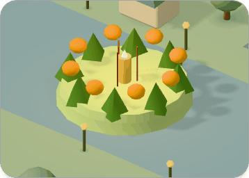 |  |  |
| Customize, 390×844 |  | 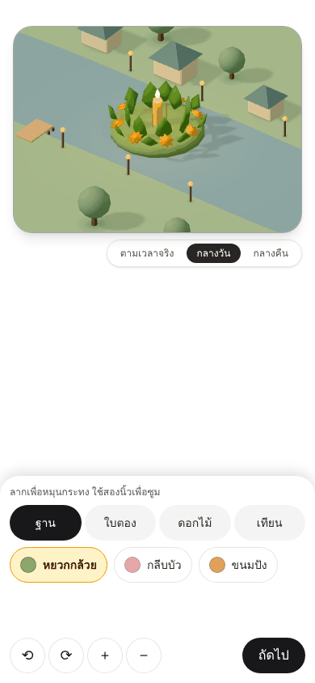 | 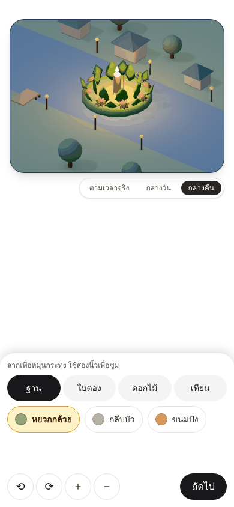 |
| Customize, 1440×900 | 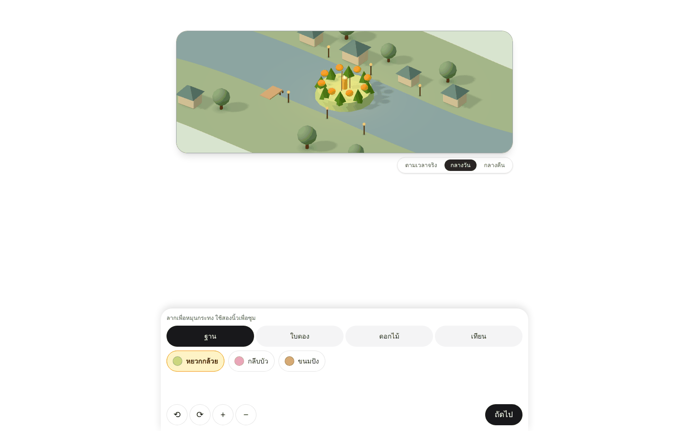 |  |  |
| Pier, 390×844 | — |  | 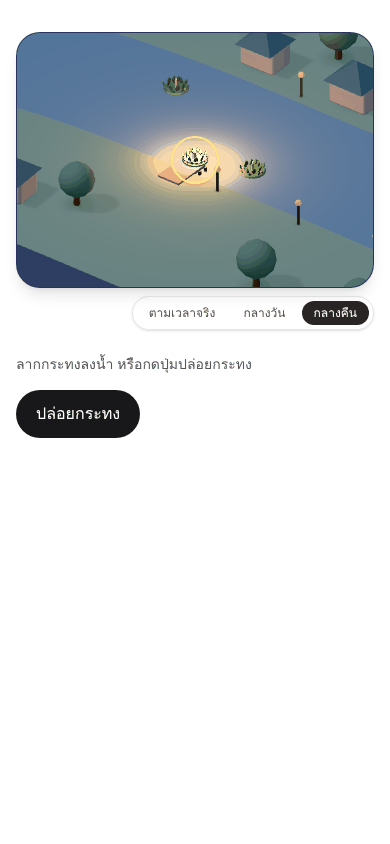 |
| Pier, 1440×900 | — | 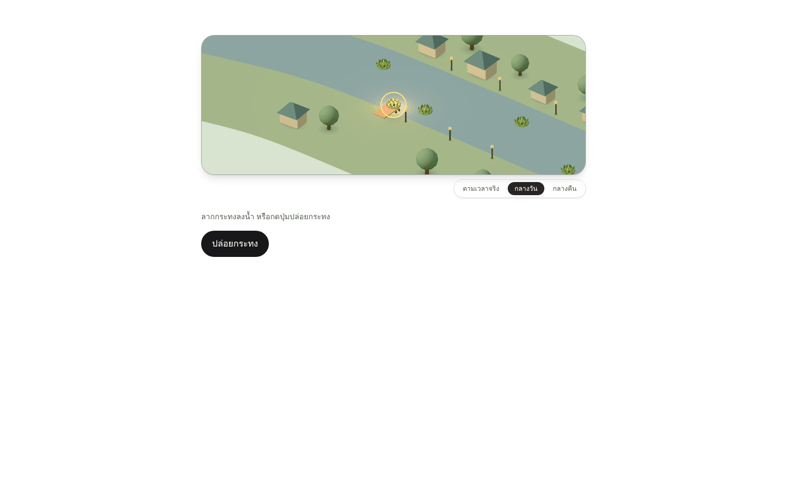 |  |
| World, 390×844 | — | 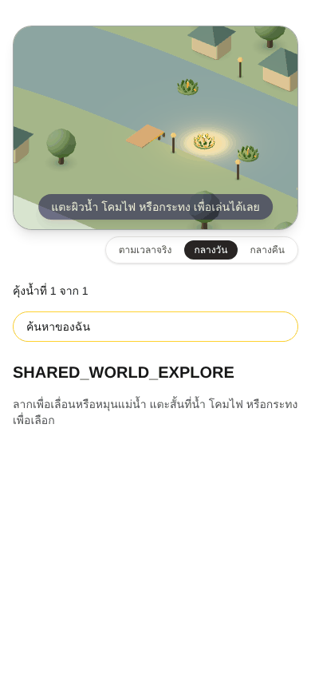 |  |
| World, 1440×900 | — | 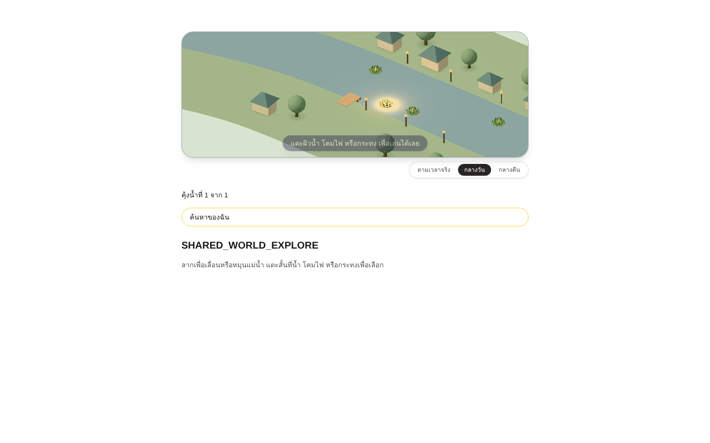 |  |

Other options (day, close-up):
- 
- 

Before-night customize shots: `screenshots/mfw-48/before-*-customize-night.png`.

## 11. Riverside v2 (MFW-49, backlog 9.3)

Config: `src/config/events/loyKrathong.river.config.ts` (geometry, placements, paths, water motion), `look.config.ts`
(`VILLAGE_LIGHTS`, `LAMP_LIGHT_POOL_LOOK`, `WATER_HIGHLIGHT_LOOK`, `stone`) and `performance.config.ts`
(`WATER_EFFECT_TIERS`, `ENVIRONMENT_RENDER_BUDGETS`). Config wins over this note.

### 11.1 Wider river

- Channel 3.2 → **4.8** world units (×1.5); lane 2.4 → **3.0** (×1.25). DRAFT: the owner approves the width from the PR
  screenshots (open question 38). `ZONE_ITEM_CAP` stays 80.
- The lane is the widest that keeps `RIVER_COLLISION_CURVATURE_MARGIN` (1.1) valid on the bends: at lane 3.2 or more,
  krathongs on the inner bend edge would overlap (inner-bend world spacing 0.5708 < 2 × `RIVER_COLLISION_RADIUS` = 0.572).
- The centreline control points are unchanged, so arc length, progress → place mapping and along-spacing are the same:
  every stored `SplinePathCoord` keeps its place along the river; lateral spacing only grows (×1.25), so stored pairs stay
  legal (`loyKrathong.river.lanes.test.ts` L1–L6).
- The pier reaches further into the wider water: `overWaterLength` 0.35 → 0.6, `releaseInset` 0.3 → 0.35. The tip
  (lateral 2.4 − 0.6 = 1.8) stays outside the lane edge (1.5); the release spot stays clamped to the body limit (0.4047).
- 2D: `FLAT_RIVER_END_MARGIN_PROGRESS` 0.05 → 0.06 keeps the % 1 wrap off the map with the wider lane.

### 11.2 Land

- Each bank is a 5-point cross-section (`RIVER_BANK_PROFILE`, offsets from the channel edge): a rounded lip from under
  the water (y −0.26) up to the village terrace (`RIVER_BANK_TOP_Y` −0.14) at 0.25, a flat terrace to 3 (lamps, path,
  village), then a gentle rise to 0.08 at the bank edge (`bankWidth` 5). Smooth vertex normals round the lip; the
  shoreline is the clean intersection of the water and the lip.
- A flat ground (`RIVER_GROUND`, radius 40 (MFW-68: covers the largest view from anywhere in the pan bounds), below the water) lies around everything so no viewport shows background. It is
  a disc with a hole shaped like the river + banks outline (`buildGroundHoleOutline`: the outer bank edges pulled in by
  `holeMargin` 1), so it never overdraws the water or banks, and no camera ray passes under a bank edge into the hole. It is
  drawn last among opaque meshes (`RIVER_GROUND_RENDER_ORDER`). See §11.7 for why it is not a plain disc.
- Puffy rounded trees (detail-1 canopies), squashed bushes (`bush`), faceted riverside rocks (`rock`, palette `stone`) and
  the wooden pier. Props stand on the profile: base y = `bankSurfaceY(profile, setback)`.

### 11.3 Village and lights

- 7 houses: 5 on the far bank, 2 on the near bank turned to face the camera (`yawOffsetRad` π) so their lit windows show.
- Two roof kinds and colours: teal pyramid (`houseRoof`) and terracotta gable (`houseRoofGable`), one InstancedMesh each
  (no per-instance colour: it would add a shader variant on SwiftShader). Walls stay cream.
- `HOUSE_FACADE`: one door and two windows on each house front (local +Z), resolved by `resolveHouseFeatures`.
- `VILLAGE_LIGHTS` (DRAFT): NIGHT windows 0.9 and lanterns 1.2 emissive and warm additive lamp light pools
  (`LAMP_LIGHT_POOL_LOOK`, radius 0.55, opacity 0.35); DAY all off. Emissive is a uniform, so a preset switch recompiles
  nothing and creates nothing. No new lights (the light count is part of every program key).
- The krathong flame stays the brightest surface in both presets (`riverLayout.test.ts`).

### 11.4 Riverside walking path (contract for MFW-50)

- `LOY_KRATHONG_RIVERSIDE_PATHS` (DRAFT): path 1 on the far bank (side −1, setback 0.6), path 2 on the near bank (side 1,
  setback 0.9, behind the pier's bank end at 0.5); both half-width 0.2 over the whole river (progress 0 → 1), on the flat
  terrace.
- `riversidePathPoseInto(channel, path, profile, progress, across, out)` is MFW-50's only entry point. It is allocation-free
  and render-time only (never persisted, invariant A): it writes x, y (the bank surface), z and the downstream flow yaw for
  `progress` (clamped to the path) and `across` ∈ [−1, 1] (clamped; ±1 = the strip edges).
- Clearance guarantee (`riverLayout.test.ts` R6): no house, tree, bush, rock or lamp footprint overlaps a strip, and the pier
  ends before the near-bank strip.
- MFW-50 must keep villagers on the strip (never on the water or through props), must not persist their positions, and
  decides whether the path is drawn (today it is invisible).

### 11.5 Water

- Soft colour (`water` palette) plus three vertex-alpha fans that all share the blob-shadow program (no new shader):
  - shore band (`RIVER_WATER_HIGHLIGHTS.shore`, 0.35 wide, alpha 1 at the bank → 0): every 3D tier, static;
  - drifting glints near both banks (`waterGlintPoseInto`): `WATER_EFFECT_TIERS` HIGH 6, MEDIUM 6, LOW 0;
  - a soft ripple ring around each river krathong (`krathongRippleScale`): HIGH / MEDIUM, one draw call for the zone.
- LOW (the cheap variant) = the static shore band only. Reduced motion = glints written once at t = 0 and a constant
  ripple radius.
- Glints never call `invalidate()`: they move whenever the scene already renders continuously (the shared world, where
  krathongs drift) and stay still in CUSTOMIZE / RITUAL (no extra rendering on idle views).

### 11.6 Budget and numbers

Environment main pass, no river krathongs (`environmentBudget.test.tsx` counts it with the real builders; guard
`ENVIRONMENT_RENDER_BUDGETS`). MFW-47 environment for comparison: 12 calls; 3 228 triangles HIGH, 2 886 LOW.

| Tier | NIGHT calls / triangles | DAY calls / triangles | Budget calls / triangles |
|---|---|---|---|
| HIGH | 21 / 5 834 | 20 / 5 450 | 21 / 6 500 |
| MEDIUM | 21 / 5 378 | 20 / 5 090 | 21 / 5 850 |
| LOW | 20 / 4 970 | 19 / 4 730 | 20 / 5 400 |

The ground (disc with the river-shaped hole) has 126 triangles. Ripples add `KRATHONG_RIPPLE_MAX_TRIANGLES` (48; the ring has 32) per
rendered krathong and one draw call on HIGH / MEDIUM.
To hold the SwiftShader CI frame budget, the spec's four ordered cuts were applied: HIGH glints 10 → 6, ripple ring 12 → 8
segments, bushes 8 → 6 and rocks 6 → 4, `ribbonSegments` 64 → 48. Measured numbers: §11.7.

### 11.7 Measured numbers (local container, SwiftShader)

Rebased on main ce0f2e4 (MFW-47, 48, 54, 55, 57): full-screen stage, `?pinTier=1`, world view after release, 390×844.

- Ground: the spec's full disc shades the pixels hidden under the water and banks (SwiftShader does not reject them early);
  on the old 256-px stage it cost about 25 % of the HIGH frame. The ground now has a hole shaped like the river + banks
  outline, so it overdraws nothing. On the full-screen stage its *visible* area still costs frame time on SwiftShader (it
  replaces background that main clears for free): LOW 60 → 46 fps with it, 60 without (measured variant).
- e2e `perf-audit.spec.ts` (`[perf-audit]` lines), main → MFW-49:
  - HIGH world (one or a full zone): calls 32 → 42 (flat with the krathong count); triangles 5 864 → 8 396 (one) and
    96 240 → 101 300 (full zone, ripples included). HIGH CUSTOMIZE: calls 78 → 87, triangles 6 816 → 9 316, programs 8 → 8.
  - LOW zone switches: 20 → 27 calls, flat; geometries 22 → 29, flat; programs 8 → 8.
  - Probe soak (80 river krathongs): calls 31 → 38, triangles 26 982 → 29 132, geometries 27 → 34, programs 8 → 8; every
    counter flat across 20 zone switches.
- World view `?perfProbe=1` (calls / triangles / programs; programs include the probe panel's):
  - HIGH: DAY 78 / 6 816 / 9 → 87 / 9 378 / 9; NIGHT 78 / 6 816 / 9 → 88 / 9 762 / 9.
  - MEDIUM: DAY 43 / 4 060 / 5 → 51 / 6 150 / 5; NIGHT 43 / 4 060 / 5 → 52 / 6 438 / 5.
  - LOW: DAY 43 / 3 940 / 5 → 50 / 5 784 / 5; NIGHT 43 / 3 940 / 5 → 51 / 6 024 / 5.
  - No new shader program on any tier.
- FPS (3 s rAF count, tier pinned, load < 4): HIGH 34–40 → 23–26; MEDIUM 49–57 → 31–34; LOW 59–60 → 43–49. Without the
  ground: HIGH 28–31, LOW 59–60.
- The e2e suite passes on MFW-49 (`--workers=1`, tiers pinned).
- Real phone GPUs are far from these limits (a flat lit plane is trivial on a GPU); the on-device check is in
  `docs/follow-ups.md`.

### 11.8 DRAFT values (MFW-49)

Channel and lane widths, pier `overWaterLength` / `releaseInset`, `RIVER_BANK_PROFILE`, `bankWidth`, `RIVER_GROUND`,
`HOUSE_FACADE`, every placement, the new parts (`houseRoofGable`, `houseDoor`, `houseWindow`, `bush`, `rock`), `stone`,
`VILLAGE_LIGHTS`, `LAMP_LIGHT_POOL_LOOK`, `WATER_HIGHLIGHT_LOOK`, `RIVER_WATER_HIGHLIGHTS`, `LOY_KRATHONG_RIVERSIDE_PATHS`.
Lead guards (not product numbers): `WATER_EFFECT_TIERS`, `ENVIRONMENT_RENDER_BUDGETS`, `KRATHONG_RIPPLE_MAX_TRIANGLES`.

### 11.9 Before / after (MFW-49)

Production build, SwiftShader WebGL, HIGH tier (pinned), shared world view after release, on the MFW-54 full-screen stage.
Before = the MFW-47 screenshots (256-px stage).

| | Before (MFW-47) | After — day | After — night |
|---|---|---|---|
| World, 1440×900 |   |  | 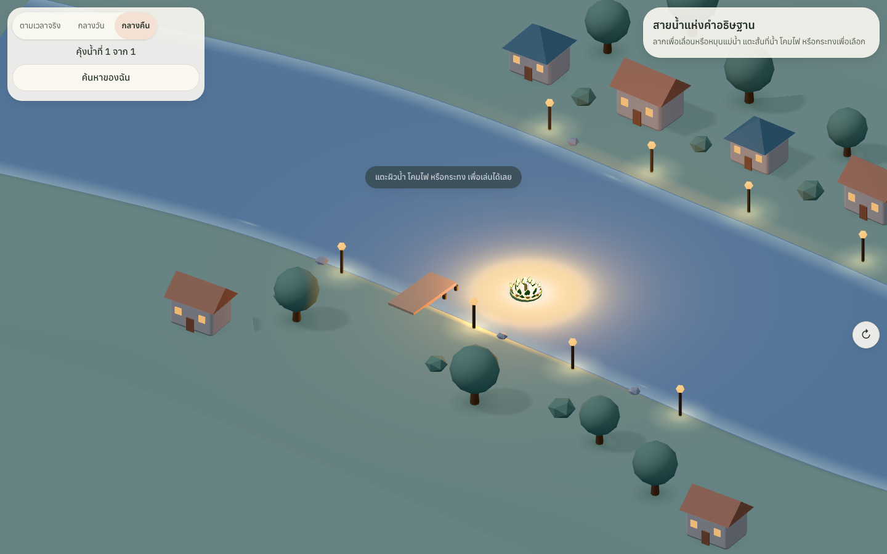 |
| World, 390×844 | — |  | 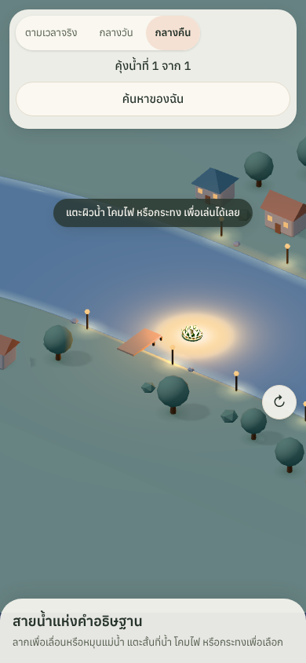 |
