# Loy Krathong look v2 — art direction (MFW-47, backlog 9.1)

Every value here mirrors `src/config/look.config.ts`; config wins.

Owner decisions: open question 27 (visual target) and open question 32 (day / night), both 2026-11-25.

## 1. Visual target

The target is `docs/spec/assets/loy-krathong-look-ref.png`.

The image is a 3/4 isometric, toy/clay diorama in soft overcast daylight. It shows pale sage land, a calm blue-grey
river, cream houses with a muted teal roof and a terracotta roof, round blob trees on short brown trunks, a light
wooden pier, and a green banana-leaf krathong with coral/cream flowers and a glowing candle. Every edge is rounded.
Nothing is glossy, and no pixel is near-black. Shadows are soft, low-contrast, green/blue-grey blobs under trees,
houses and the krathong, with no hard edges. The light comes from the upper left and the fill is strong and even:
the shadow side of a house is only about 35 % darker than its lit side.

## 2. Palette (`LOOK_PALETTE`)

Sampled from the reference image (median colour per region). All values are DRAFT until the owner signs off on the
screenshots. "Reserved" keys are not used yet; the listed card builds on them.

| Key | Hex | Use |
|---|---|---|
| grass | #A7BA96 | lit land (banks) |
| grassShade | #5E6D54 | land in contact shade under trees — reserved for 9.3 |
| water | #90AAAE | river body |
| waterLight | #ACC3C7 | river highlight near the bank — used since MFW-49 (shore band, glints, krathong ripples) |
| waterDeep | #546970 | water in shade by the bank / under the pier — used since MFW-49 (window glass) |
| wallCream | #E4D4B3 | house walls |
| roofTeal | #718C86 | pyramid house roofs |
| roofTerracotta | #D1936B | gable house roofs — used since MFW-49 |
| doorWood | #B9815A | house doors — used since MFW-49; krathong incense sticks (MFW-48) |
| woodLight | #D4AE82 | pier deck |
| woodDark | #725F46 | pier posts, lamp posts |
| trunk | #7C5D40 | tree trunks |
| canopy | #8CA682 | tree canopies |
| canopyShade | #4E644E | canopy shade side — reserved for 9.3 |
| leafLight | #8DA667 | krathong banana leaf, lit — banana-trunk base (MFW-48) |
| leafDark | #3F5B35 | krathong banana leaf, shade — reserved for 9.2 |
| flowerCoral | #E19A7C | krathong flower petals — reserved for 9.2 |
| flowerCream | #EBDFC4 | pale krathong petals — reserved for 9.2 |
| flowerYellow | #F2D585 | flower centres (krathong, MFW-48), lamp heads |
| candleWax | #D5B279 | candle body — reserved for 9.2 |
| flameCore | #FDF7C6 | flame core — krathong flame albedo (MFW-48) |
| flameHalo | #F9EAA6 | flame halo — reserved for 9.2 |
| lanternGlow | #FFC46B | warm lamp emissive |
| shadowTint | #40564A | blob-shadow tint (dark sage, never black) |
| daySky | #D8E4CF | DAY background (pale sage haze) |
| nightSky | #2E3E63 | NIGHT background (deep periwinkle, not black) |
| stone | #B9B7A8 | riverside rocks; not in the reference, DRAFT (MFW-49) |

## 3. Material rules

- Matte only: roughness 1, metalness 0 (the `MatteMaterialSpec` literal types enforce it).
- Curved parts are smooth-shaded (`flatShading: false`): rounded house bodies, cylinders (trunks, posts, piles),
  icosahedron canopies (detail 1) and the small lamp heads. Planar pyramids (roofs) stay flat-shaded.
  - Instanced parts share one shader program: a flat-shaded part spec gets its flatness baked into per-face normals
    (`createInstancedPartGeometry`) and a smooth-shaded material. It looks the same and avoids a second program compile.
  - Banks (flat ribbons with up normals) and the deck (a box) use `flatShading: false`. They look the same and share
    the water / krathong program.
- House bodies are bevelled: `roundedBox` with radius 0.06 and 1 bevel segment (108 triangles), smooth-shaded so the
  edge reads rounded. The lead's draft had 2 segments (300 triangles); at the scene's size the two look the same, and
  the extra triangles cost frame time in the SwiftShader e2e (see §7). The per-part low-poly guard
  `ENVIRONMENT_PART_MAX_TRIANGLES` is 128 (largest part 108).
- Lamp heads stay icosahedron detail 0 (about 7 px on screen), smooth-shaded.
- Pastel: no environment albedo below `LOOK_MIN_ALBEDO_LUMINANCE` = 0.1 (WCAG relative luminance).
- No black shadows: the key-light shadow has `shadow.intensity` < 1, and blob shadows are a translucent sage tint.
- Readability guard (AC3): the estimated lit luminance (`estimateLitLuminance`, linear Lambert before tone mapping)
  of every environment surface, up-facing and camera-facing side, is ≥ `LOOK_MIN_LIT_LUMINANCE` = 0.025 in both
  presets. The MFW-27 night look scored ≤ 0.014 and fails it.

## 4. Light presets (`LIGHT_PRESETS`)

Renderer: Neutral tone mapping (`LOOK_RENDERER`, exposure 1). It keeps the pastel albedo close to the sampled hexes;
R3F's default ACES darkens and shifts them. All lights are world-fixed (outside the pan/rotate group).

| Field | DAY | NIGHT |
|---|---|---|
| background | #D8E4CF (daySky) | #2E3E63 (nightSky) |
| hemisphere sky / ground / intensity | #EEF2EC / #A7BA96 / 1.6 | #A9B9E6 / #5B6A86 / 1.7 |
| ambient colour / intensity | #FFFFFF / 0.4 | #8FA2D6 / 0.5 |
| key (sun / moon) colour / intensity / position | #FFF4E3 / 2.4 / [-5, 6.5, 5] | #CAD7FF / 1.3 / [-4, 7, 3] |
| key shadow intensity / radius / bias / normalBias | 0.5 / 5 / -0.0005 / 0.02 | 0.4 / 5 / -0.0005 / 0.02 |
| candle point light scale | 0.15 | 1 |
| flame emissive intensity | 2.2 | 3.0 |

DAY was tuned from the lead's draft on the screenshots: a cooler sky fill (#F6F2E6 → #EEF2EC) and a less orange
sun (#FFF0D9 → #FFF4E3) keep the river blue-grey, and a lower sun ([-5, 8, 4] → [-5, 6.5, 5]) lights the cream walls
as in the reference instead of only the ground.

Candle and flame:

- The own-krathong candle point light is `TOY_SCENE_LIGHTING.candle` × the preset's `candle.intensityScale`. Since
  MFW-67 (DRAFT): #ffb35c, intensity 1.0 in krathong model units (was 14), distance 2 × footprint = 2.6 (was 7), decay 2,
  scaled by the pose (distance × s, intensity × s², so CUSTOMIZE and the 0.22-scaled river pose look the same) and kept
  under the guard `CANDLE_MAX_PEAK_RADIANCE` (no clipped yellow disc). The scale is applied through a spring
  interpolation, so a preset switch never restarts a release.
- The shared krathong flame material is not tone-mapped (`KRATHONG_FLAME_GLOW`), and its emissive intensity is set
  per preset. That makes the flame the brightest surface in both presets without a bloom pass (guarded in
  `riverLayout.test.ts`).
- Lamp heads are pale yellow with a small warm emissive (lanternGlow, 0.35). Per-preset lamps and lit windows are 9.3.

A preset change is an instant cut (no cross-fade), so it is safe under reduced motion by construction.

## 5. Shadows

- HIGH: the tier's key-light shadow map (`MOON_SHADOW_MAP_SIZE_PX`, clamped to the tier texture size). three 0.187
  maps R3F's soft type to PCF, which honours `shadow.radius` 5; `shadow.intensity` 0.4–0.5 under a strong hemisphere
  fill keeps shadows soft and never black. Plus the blob shadows below.
- MEDIUM / LOW: no shadow map (tier budget); blob shadows only.
- Blob shadows on every 3D tier: vertex-alpha fans (`buildBlobShadowFan`, no texture), alpha 1 at the centre falling to
  0 at the rim (`falloffExponent` 1.6), tint `shadowTint` at opacity 0.35, lifted 0.006 above the surface with a
  polygon offset.
  - Fan resolution (`BLOB_SHADOW_TIER_GEOMETRY`, segments × rings): HIGH 16×2 (48 triangles), MEDIUM 12×2 (36),
    LOW 10×2 (30, the cheap variant). The lead's draft had HIGH 24×3 and MEDIUM 16×3; lowered for the same e2e frame
    budget, with no visible difference.
  - Radii (`RIVER_ENVIRONMENT_BLOB_SHADOWS`, local units × instance scale): houses 0.56 × 0.44, trees 0.42, lamps 0.1.
  - Own krathong: `KRATHONG_BLOB_SHADOW` radius 1.45 model units at the water line. River krathongs:
    `RIVER_KRATHONG_BLOB_SHADOW_RADIUS` = 1.45 × `RIVER_KRATHONG_SCALE` world units, moved per frame with the krathong.
  - Three draw calls in total (environment, river and own-krathong InstancedMeshes; the own-krathong one holds a single
    instance so it shares the blob program), whatever the number of krathongs.
  - Blobs ignore raycasts (`NO_RAYCAST`), so they never steal a tap from the water, props or krathongs.

## 6. Time of day and the switch

- AUTO (default) follows the device's local clock: DAY from 06:00 to 18:00, NIGHT otherwise (`DAY_NIGHT_HOURS`,
  PLACEHOLDER). One timer fires at the next boundary, and the clock is re-read when the tab becomes visible again.
  There is no per-frame or per-second work.
- The switch below the scene ("แสงในฉาก": ตามเวลาจริง / กลางวัน / กลางคืน) overrides AUTO. It is hidden before profiling
  and when WebGL is unavailable (the stage then shows only a notice, MFW-71).
- The choice is a per-device display preference. It is kept only in this device's LocalStorage under
  `mfw:lightPreset:v1` ("DAY" or "NIGHT"; AUTO = no key) and in `useDeviceStore.lightPresetChoice`. It is never sent
  to the server and is not creation data.
- SSR snapshot: NIGHT (`LIGHT_PRESET_SERVER_FALLBACK`); the scene never renders on the server.

## 7. Tiers and performance

- The per-tier budgets in `performance.config.ts` are unchanged. Every environment part stays one InstancedMesh, so
  the rounded shapes add triangles but no draw calls.
- e2e `perf-audit.spec.ts` numbers (SwiftShader, local container), before (BASE fe5c4bf) → after (MFW-47):
  - "Draw calls do not grow" (ran at MEDIUM both times): 17 → 19 draw calls with one or a full zone of river
    krathongs; triangles 1 440 → 3 416 (one krathong) and 19 300 → 22 968 (full zone).
  - LOW zone switches: 17 → 19 draw calls, flat across 20 switches; geometries 18 → 21, flat; programs 8 → 8.
  - Probe soak (80 river krathongs): 28 → 30 draw calls, 23 168 → 26 134 triangles, geometries 23 → 26, programs
    8 → 8; every counter flat across 20 zone switches.
  - Draw calls do not grow with the number of river krathongs, before or after.
  - Measured +2 calls (environment and river blobs). The own-krathong blob adds a third call whenever the own krathong is
    drawn; the audited WORLD_EXPLORE views do not draw it.
- SwiftShader frame budget: the e2e profiler drops HIGH / MEDIUM to LOW below 20 FPS. SwiftShader renders and
  compiles shaders on the CPU, so triangles and shader programs cost real frame time there; a tier step-down
  re-creates the canvas and recompiles every program.
  - The lead's draft had about 2.8× BASE's triangles in the HIGH world view (11 592 against 4 200) and 12 programs
    against 8, and the HIGH e2e specs stepped down under load more often than BASE.
  - With 1-segment house bevels, detail-0 lamp heads, lighter blob fans, a one-instance krathong blob and shared
    instanced / planar programs it has 7 488 triangles and 8 programs, the same program count as BASE.
  - Real phone GPUs are far from this limit; the on-device check is in `docs/follow-ups.md`.
- Reduced motion: nothing in the look animates (lights, blobs, preset change), so the output is identical with
  reduced motion on.

## 8. What 9.2–9.5 build on

- 9.2 (MFW-48, krathong models): leafLight, leafDark, flowerCoral, flowerCream, flowerYellow, candleWax, flameCore,
  flameHalo; the flame-glow rule; `KRATHONG_BLOB_SHADOW`.
- 9.3 (MFW-49, river and environment): waterLight, waterDeep, roofTerracotta, doorWood (used, §11); per-preset lamps,
  lit windows, wider water. grassShade and canopyShade stay unused (the lit matte program shades them).
- 9.4 (MFW-50, villagers): the palette and the blob-shadow helpers (`DynamicBlobShadows`).
- 9.5 (MFW-51, 2D): the same palette; a 2D day/night preset and switch (removed in MFW-71).

## 9. DRAFT / PLACEHOLDER values

- DRAFT: every `LOOK_PALETTE` hex; every `LIGHT_PRESETS` value; `LOOK_RENDERER`; `BLOB_SHADOW_LOOK`;
  `BLOB_SHADOW_TIER_GEOMETRY`; `KRATHONG_BLOB_SHADOW`; `RIVER_ENVIRONMENT_BLOB_SHADOWS`; the switch copy and its visual
  design; the instant-cut preset change.
- PLACEHOLDER: `DAY_NIGHT_HOURS` (06:00–18:00).
- Lead guards (not product numbers): `LOOK_MIN_LIT_LUMINANCE` 0.025, `LOOK_MIN_ALBEDO_LUMINANCE` 0.1,
  `ENVIRONMENT_PART_MAX_TRIANGLES` 128.

## Before / after (MFW-47)

Captured on the production build with SwiftShader WebGL (HIGH tier, before the full-screen stage of MFW-54).

| | Before (night only) | After — day | After — night |
|---|---|---|---|
| World, 1440×900 |  |  |  |
| Customize, 390×844 |  |  | — |

## 10. Krathong v2 (MFW-48)

Superseded in part by §13 (krathong v3 detail, MFW-69): leaves, flowers, base lip, candle and flame shapes and the per-tier LOD.

Backlog 9.2. Every value mirrors `src/config/krathongModel.config.ts` (config wins) and is **DRAFT**: the owner reviews it
from the screenshots below. Appearance keys and stored appearance data are unchanged, so saved krathongs render with v2.
The same model is drawn in the customizer, at the pier and on the river; the river uses the instanced batch.

### Shapes

All parts are parametric clay meshes. Each is an indexed closed solid with smooth normals, built by
`src/core/customization/krathongMeshData.ts`.
- Bases:
  - banana trunk: a puffy rounded drum (lathe);
  - lotus: two layers of rounded petal lobes;
  - bread: a rounded dome.
  Leaves and flowers sit on each base's `rimY`.
- Leaves: 8 units, each with two folded blades (a diamond cross-section gives the centre ridge).
  - A shorter outer blade flares out with its tip curled up.
  - A taller inner blade stands almost upright on the flower-socket angle.
  - style_01 is pointed, style_02 is broader and rounder.
  - A fixed per-leaf yaw / scale jitter (`KRATHONG_LEAF_VARIATION`) makes the ring look hand-made.
- Flowers face up and outward (`KRATHONG_FLOWER_TILT_RAD`), each with a round centre part:
  - marigold: two star-petal layers;
  - orchid: 5 rounded petals;
  - lotus: two pointed layers.
- Candle: a tall slim lathe (0.7) with a rounded top rim, in the stored candle colour.
- Flame: a teardrop on the candle tip.
- Incense: 3 slim sticks.
- The 2D fallback is unchanged in code. It reads the same assembly, so it picks up the v2 proportions, the leaf variation and
  one small yellow ellipse per flower centre. Full 2D art followed in MFW-51 (§15), which replaced this.

### Palette use

- Banana base: `leafLight`.
- Flower centres: `flowerYellow`. Its WCAG contrast with every petal colour is ≥ `KRATHONG_FLOWER_CENTRE_MIN_CONTRAST` 1.25.
- Flame albedo: `flameCore`, with the MFW-47 warm emissive, not tone-mapped.
- Incense: `doorWood`.
- The stored leaf and candle hexes stay the material colours. The v1 flower hues stay (open question below).

### Flame flicker

- Two slow sines, at 1.1 and 1.9 Hz. Every component is ≤ `FLAME_FLICKER_MAX_HZ` 3 (WCAG 2.3.1 three flashes); the unit
  test counts ≤ 3 maxima in any 1 s window.
- Amplitudes: height ±8 %, width ∓4 %, emissive ±4 %. The peak-to-peak emissive swing of 8 % stays below
  `FLAME_FLICKER_MAX_EMISSIVE_SWING` 10 % (WCAG general-flash threshold).
- One shared frame per canvas, so all flames flicker in sync.
- Static under reduced motion.
- Redraw cadence in an idle demand canvas: `FLAME_FLICKER_REDRAW_INTERVAL_MS` 100 / 125 / 150 ms (HIGH / MEDIUM / LOW).
  See `docs/perf/MFW-48.md` for its cost on SwiftShader.

### Budgets

- No new shader program (`MeshStandardMaterial`, FrontSide, smooth, opaque), no texture.
- Triangles per krathong:
  - default 1 024 (v1 1 360);
  - worst 1 088 (guard `KRATHONG_MAX_TRIANGLES` 1 200);
  - e2e fixture 548 (v1 380).
- Hero model: ≤ 30 meshes. River batch: 18 InstancedMesh (+1 flower-centre bucket).
- Footprint radius ≤ 1.288 (guard `KRATHONG_MODEL_FOOTPRINT_RADIUS` 1.3).

### DRAFT list

- Every `mesh` spec, `rimY`, part `localY`, `KRATHONG_LEAF_VARIATION`, `KRATHONG_FLOWER_TILT_RAD` and `centreScale`.
- The candle height 0.7 (v1 0.5).
- The banana-base, flame and incense colours.
- `FLAME_FLICKER` and `FLAME_FLICKER_REDRAW_INTERVAL_MS`.
- The leaf and flower sizes were enlarged by the dev from the lead's draft after the screenshots; see the MFW-48 dev report.
- Lead guards (not product numbers): `KRATHONG_MAX_TRIANGLES`, `KRATHONG_FLOWER_CENTRE_MIN_CONTRAST`,
  `FLAME_FLICKER_MAX_HZ`, `FLAME_FLICKER_MAX_EMISSIVE_SWING`.

### Before / after (MFW-48)

Captured on the production build with SwiftShader WebGL, HIGH tier.

| | Before (MFW-47) | After — day | After — night |
|---|---|---|---|
| Krathong close-up, 390×844 (zoomed in) |  |  | 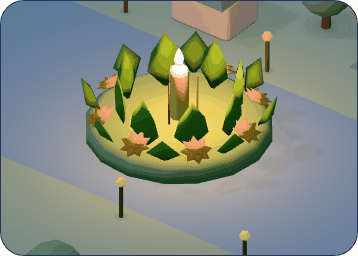 |
| Customize, 390×844 |  |  |  |
| Customize, 1440×900 |  | 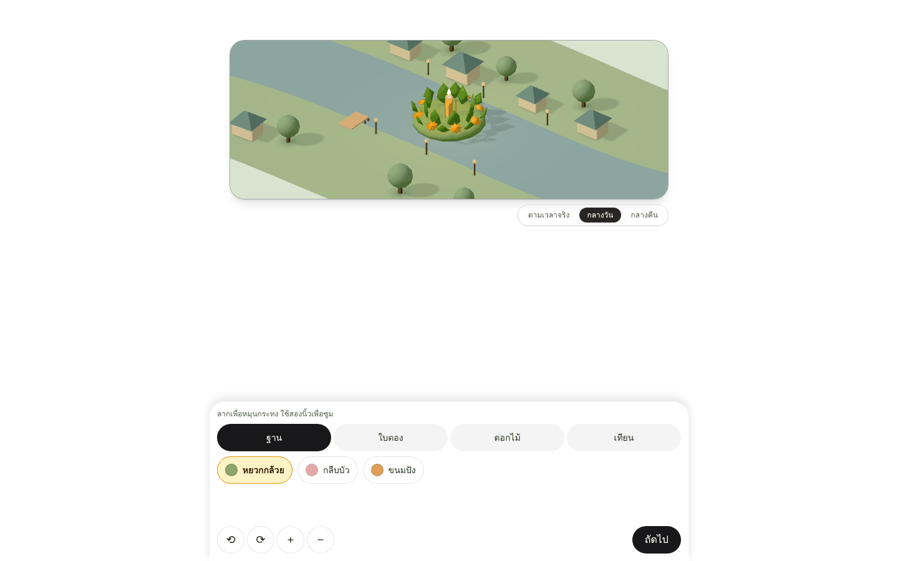 | 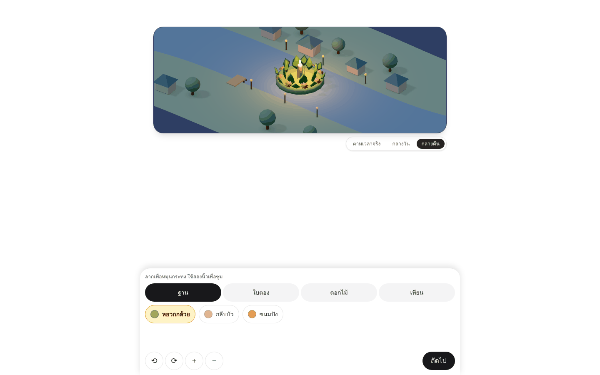 |
| Pier, 390×844 | — | 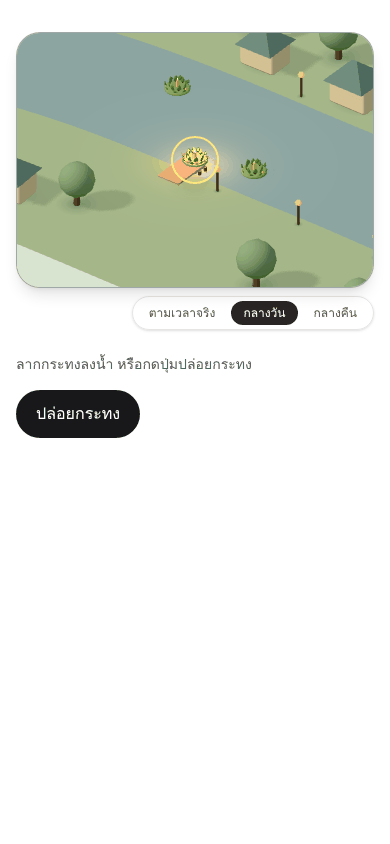 |  |
| Pier, 1440×900 | — |  | 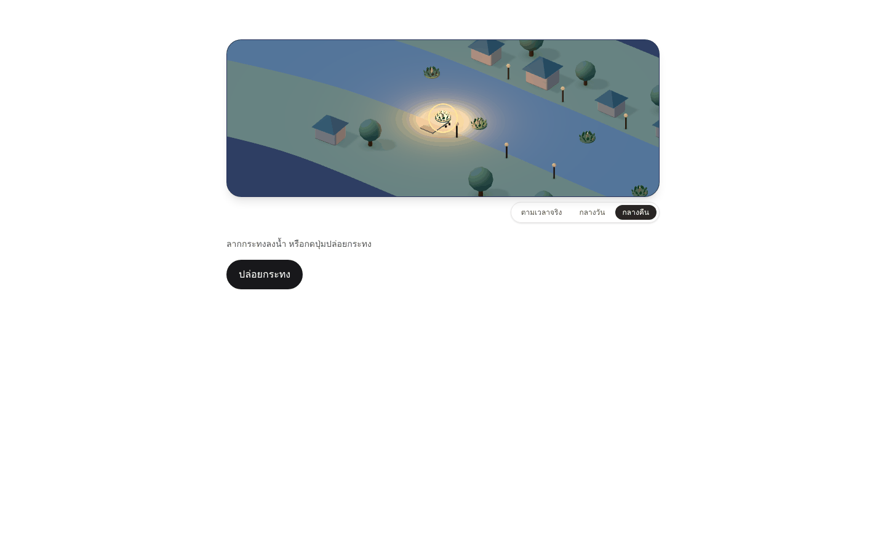 |
| World, 390×844 | — |  | 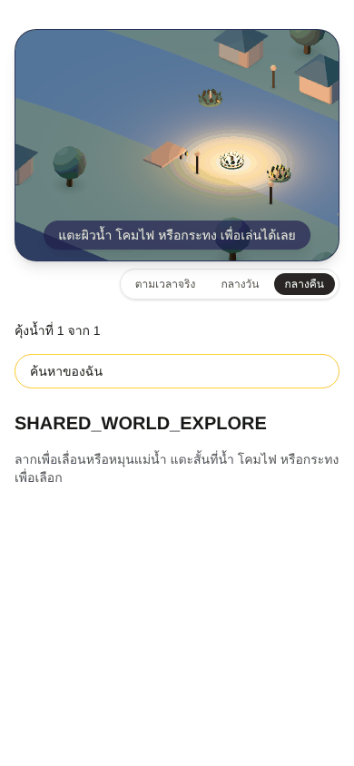 |
| World, 1440×900 | — |  | 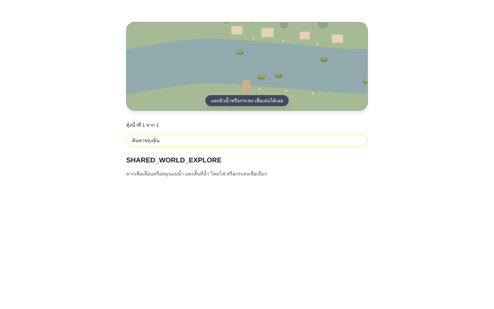 |

Other options (day, close-up):
- 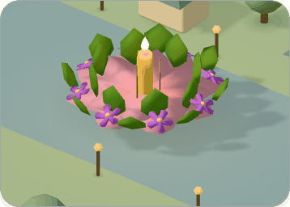
- 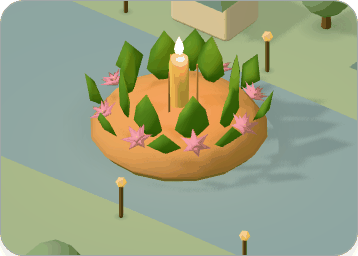

Before-night customize shots: `screenshots/mfw-48/before-*-customize-night.png`.

## 11. Riverside v2 (MFW-49, backlog 9.3)

Config: `src/config/events/loyKrathong.river.config.ts` (geometry, placements, paths, water motion), `look.config.ts`
(`VILLAGE_LIGHTS`, `LAMP_LIGHT_POOL_LOOK`, `WATER_HIGHLIGHT_LOOK`, `stone`) and `performance.config.ts`
(`WATER_EFFECT_TIERS`, `ENVIRONMENT_RENDER_BUDGETS`). Config wins over this note.

### 11.1 Wider river

- Channel 3.2 → **4.8** world units (×1.5); lane 2.4 → **3.0** (×1.25). DRAFT: the owner approves the width from the PR
  screenshots (open question 38). `ZONE_ITEM_CAP` stays 80.
- The lane is the widest that keeps `RIVER_COLLISION_CURVATURE_MARGIN` (1.1) valid on the bends: at lane 3.2 or more,
  krathongs on the inner bend edge would overlap (inner-bend world spacing 0.5708 < 2 × `RIVER_COLLISION_RADIUS` = 0.572).
- The centreline control points are unchanged, so arc length, progress → place mapping and along-spacing are the same:
  every stored `SplinePathCoord` keeps its place along the river; lateral spacing only grows (×1.25), so stored pairs stay
  legal (`loyKrathong.river.lanes.test.ts` L1–L6).
- The pier reaches further into the wider water: `overWaterLength` 0.35 → 0.6, `releaseInset` 0.3 → 0.35. The tip
  (lateral 2.4 − 0.6 = 1.8) stays outside the lane edge (1.5); the release spot stays clamped to the body limit (0.4047).
- 2D: `FLAT_RIVER_END_MARGIN_PROGRESS` 0.05 → 0.06 keeps the % 1 wrap off the map with the wider lane.

### 11.2 Land

- Each bank is a 5-point cross-section (`RIVER_BANK_PROFILE`, offsets from the channel edge): a rounded lip from under
  the water (y −0.26) up to the village terrace (`RIVER_BANK_TOP_Y` −0.14) at 0.25, a flat terrace to 3 (lamps, path,
  village), then a gentle rise to 0.08 at the bank edge (`bankWidth` 5). Smooth vertex normals round the lip; the
  shoreline is the clean intersection of the water and the lip.
- A flat ground (`RIVER_GROUND`, radius 40 (MFW-68: covers the largest view from anywhere in the pan bounds), below the water) lies around everything so no viewport shows background. It is
  a disc with a hole shaped like the river + banks outline (`buildGroundHoleOutline`: the outer bank edges pulled in by
  `holeMargin` 1), so it never overdraws the water or banks, and no camera ray passes under a bank edge into the hole. It is
  drawn last among opaque meshes (`RIVER_GROUND_RENDER_ORDER`). See §11.7 for why it is not a plain disc.
- Puffy rounded trees (detail-1 canopies), squashed bushes (`bush`) (replaced by §12, MFW-70), faceted riverside rocks (`rock`, palette `stone`) and
  the wooden pier. Props stand on the profile: base y = `bankSurfaceY(profile, setback)`.

### 11.3 Village and lights

- 7 houses (MFW-77: 16, see §20): 5 on the far bank, 2 on the near bank turned to face the camera (`yawOffsetRad` π) so their lit windows show.
- Two roof kinds and colours: teal pyramid (`houseRoof`) and terracotta gable (`houseRoofGable`), one InstancedMesh each
  (no per-instance colour: it would add a shader variant on SwiftShader). Walls stay cream.
- `HOUSE_FACADE`: the window glass positions of the owner house model (MFW-66: two front, two back, one side; the window
  offsets come from `LOY_KRATHONG_HOUSE_MODEL.windows`), resolved by `resolveHouseFeatures`. Since MFW-66 the door is part
  of the house shell's vertex colours (`doorWood`); there is no separate door part (`houseDoor` removed). See
  `docs/design/models.md` §10.
- `VILLAGE_LIGHTS` (DRAFT): NIGHT windows 0.9 and lanterns 1.2 emissive (lamp light pools removed in MFW-67); DAY all
  off. Emissive is a uniform, so a preset switch recompiles
  nothing and creates nothing. No new lights (the light count is part of every program key).
- The krathong flame stays the brightest surface in both presets (`riverLayout.test.ts`).

### 11.4 Riverside walking path (contract for MFW-50)

- `LOY_KRATHONG_RIVERSIDE_PATHS` (DRAFT): path 1 on the far bank (side −1, setback 0.6), path 2 on the near bank (side 1,
  setback 0.9, behind the pier's bank end at 0.5); both half-width 0.2 over the whole river (progress 0 → 1), on the flat
  terrace.
- `riversidePathPoseInto(channel, path, profile, progress, across, out)` is MFW-50's only entry point. It is allocation-free
  and render-time only (never persisted, invariant A): it writes x, y (the bank surface), z and the downstream flow yaw for
  `progress` (clamped to the path) and `across` ∈ [−1, 1] (clamped; ±1 = the strip edges).
- Clearance guarantee (`riverLayout.test.ts` R6): no house, tree, bush, rock or lamp footprint overlaps a strip, and the pier
  ends before the near-bank strip.
- MFW-50 must keep villagers on the strip (never on the water or through props), must not persist their positions, and
  decides whether the path is drawn (today it is invisible).

### 11.5 Water

- Soft colour (`water` palette) plus three vertex-alpha fans that all share the blob-shadow program (no new shader):
  - shore band (`RIVER_WATER_HIGHLIGHTS.shore`, 0.35 wide, alpha 1 at the bank → 0): every 3D tier, static;
  - drifting glints near both banks (`waterGlintPoseInto`): `WATER_EFFECT_TIERS` HIGH 6, MEDIUM 6, LOW 0;
  - a soft ripple ring around each river krathong (`krathongRippleScale`): HIGH / MEDIUM, one draw call for the zone.
- LOW (the cheap variant) = the static shore band only. Reduced motion = glints written once at t = 0 and a constant
  ripple radius.
- Glints never call `invalidate()`: they move whenever the scene already renders continuously (the shared world, where
  krathongs drift) and stay still in CUSTOMIZE / RITUAL (no extra rendering on idle views).
- MFW-79: swells on the water's vertex normals, see §21.

### 11.6 Budget and numbers

Environment main pass, no river krathongs (`environmentBudget.test.tsx` counts it with the real builders; guard
`ENVIRONMENT_RENDER_BUDGETS`). MFW-47 environment for comparison: 12 calls; 3 228 triangles HIGH, 2 886 LOW.

| Tier | NIGHT calls / triangles | DAY calls / triangles | Budget calls / triangles |
|---|---|---|---|
| HIGH | 21 / 5 834 | 20 / 5 450 | 21 / 6 500 |
| MEDIUM | 21 / 5 378 | 20 / 5 090 | 21 / 5 850 |
| LOW | 20 / 4 970 | 19 / 4 730 | 20 / 5 400 |

The ground (disc with the river-shaped hole) has 126 triangles. Ripples add `KRATHONG_RIPPLE_MAX_TRIANGLES` (48; the ring has 32) per
rendered krathong and one draw call on HIGH / MEDIUM.
To hold the SwiftShader CI frame budget, the spec's four ordered cuts were applied: HIGH glints 10 → 6, ripple ring 12 → 8
segments, bushes 8 → 6 and rocks 6 → 4, `ribbonSegments` 64 → 48. Measured numbers: §11.7.

### 11.7 Measured numbers (local container, SwiftShader)

Rebased on main ce0f2e4 (MFW-47, 48, 54, 55, 57): full-screen stage, `?pinTier=1`, world view after release, 390×844.

- Ground: the spec's full disc shades the pixels hidden under the water and banks (SwiftShader does not reject them early);
  on the old 256-px stage it cost about 25 % of the HIGH frame. The ground now has a hole shaped like the river + banks
  outline, so it overdraws nothing. On the full-screen stage its *visible* area still costs frame time on SwiftShader (it
  replaces background that main clears for free): LOW 60 → 46 fps with it, 60 without (measured variant).
- e2e `perf-audit.spec.ts` (`[perf-audit]` lines), main → MFW-49:
  - HIGH world (one or a full zone): calls 32 → 42 (flat with the krathong count); triangles 5 864 → 8 396 (one) and
    96 240 → 101 300 (full zone, ripples included). HIGH CUSTOMIZE: calls 78 → 87, triangles 6 816 → 9 316, programs 8 → 8.
  - LOW zone switches: 20 → 27 calls, flat; geometries 22 → 29, flat; programs 8 → 8.
  - Probe soak (80 river krathongs): calls 31 → 38, triangles 26 982 → 29 132, geometries 27 → 34, programs 8 → 8; every
    counter flat across 20 zone switches.
- World view `?perfProbe=1` (calls / triangles / programs; programs include the probe panel's):
  - HIGH: DAY 78 / 6 816 / 9 → 87 / 9 378 / 9; NIGHT 78 / 6 816 / 9 → 88 / 9 762 / 9.
  - MEDIUM: DAY 43 / 4 060 / 5 → 51 / 6 150 / 5; NIGHT 43 / 4 060 / 5 → 52 / 6 438 / 5.
  - LOW: DAY 43 / 3 940 / 5 → 50 / 5 784 / 5; NIGHT 43 / 3 940 / 5 → 51 / 6 024 / 5.
  - No new shader program on any tier.
- FPS (3 s rAF count, tier pinned, load < 4): HIGH 34–40 → 23–26; MEDIUM 49–57 → 31–34; LOW 59–60 → 43–49. Without the
  ground: HIGH 28–31, LOW 59–60.
- The e2e suite passes on MFW-49 (`--workers=1`, tiers pinned).
- Real phone GPUs are far from these limits (a flat lit plane is trivial on a GPU); the on-device check is in
  `docs/follow-ups.md`.

### 11.8 DRAFT values (MFW-49)

Channel and lane widths, pier `overWaterLength` / `releaseInset`, `RIVER_BANK_PROFILE`, `bankWidth`, `RIVER_GROUND`,
`HOUSE_FACADE`, every placement, the new parts (`houseRoofGable`, `houseDoor` (removed in MFW-66), `houseWindow`, `bush`, `rock`), `stone`,
`VILLAGE_LIGHTS`, `LAMP_LIGHT_POOL_LOOK`, `WATER_HIGHLIGHT_LOOK`, `RIVER_WATER_HIGHLIGHTS`, `LOY_KRATHONG_RIVERSIDE_PATHS`.
Lead guards (not product numbers): `WATER_EFFECT_TIERS`, `ENVIRONMENT_RENDER_BUDGETS`, `KRATHONG_RIPPLE_MAX_TRIANGLES`.

### 11.9 Before / after (MFW-49)

Production build, SwiftShader WebGL, HIGH tier (pinned), shared world view after release, on the MFW-54 full-screen stage.
Before = the MFW-47 screenshots (256-px stage).

| | Before (MFW-47) | After — day | After — night |
|---|---|---|---|
| World, 1440×900 |   | 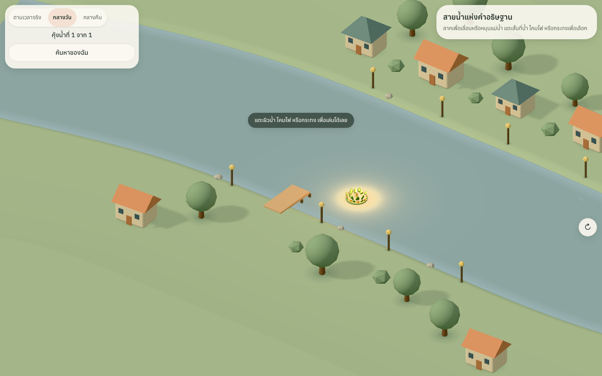 |  |
| World, 390×844 | — | 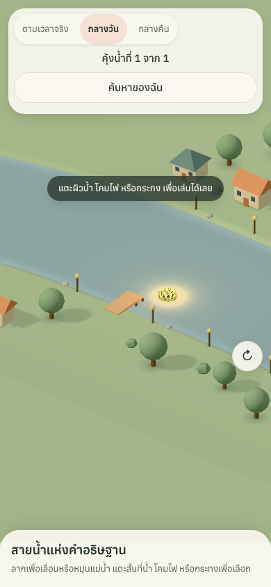 |  |

## Natural look, no rings (MFW-67, backlog 13.3)

Owner decision (open question 40, 2026-11-25): no yellow rings or halos around objects; light looks natural.

| # | Source | Fate |
|---|---|---|
| R1 | Own-krathong candle point light (`TOY_SCENE_LIGHTING.candle`, was 14 / distance 7, not scaled with the 0.22 river pose): the big yellow disc around the krathong | Replaced: intensity 1.0 (DRAFT), distance 2 × footprint, decay 2, distance × s and intensity × s² with the pose scale; guard `CANDLE_MAX_PEAK_RADIANCE` 0.76 (PBR Neutral linear limit) |
| R2 | MFW-49 lamp light pools (additive fans under the 19 lamps at NIGHT) | Removed; the lamp heads keep their emissive glow (9.3 AC3) |
| R3 | Selection / Find My highlight ring (`TargetHighlight`, `HIGHLIGHT_RING_*`) | Removed; replaced by the mark cue: one `GIMMICK_BOUNCE` + a steady `KRATHONG_MARK_CUE.scale` size-up of the marked krathong (river batch matrix, or a mark group in `OwnKrathong`) |
| R4 | Lamp light-up shell 1.35 × the head (a halo) | Kept as the lamp's cue, `LAMP_GLOW_LOOK.shellScale` 1.1 (a thin skin) |
| R5 | 2D Find My ring (`flat-focus-ring`) | Replaced by the same steady size-up of the focused sprite (`data-marked`) |
| R6 | Amber ring of the pier drag chip | Ring removed; the transparent 48-px hit target stays |
| K1 | Tap ripple (pale blue) | Kept: the water's tap cue (backlog 6.2) |
| K2 | Pale water ripple ring around each river krathong | Kept: backlog 9.3 AC4 (owner may drop it, see follow-ups) |
| K3 | Sage blob shadows | Kept (not yellow) |
| K4 | Shore highlights, water glints | Kept (bands and streaks, not rings) |
| K5 | Flame, window and lantern emissive | Kept: the small soft glow on the object itself |

DRAFT values (owner reviews them from the screenshots): candle intensity 1.0, `KRATHONG_MARK_CUE.scale` 1.2 (the largest
steady size that clears a neighbour at `RIVER_MIN_CENTER_SPACING`), `LAMP_GLOW_LOOK.shellScale` 1.1.
Under reduced motion the cue is the steady size-up only; it is a size change, so it does not depend on colour.

Screenshots (phone 390×844 unless noted): `docs/design/screenshots/mfw-67/after-phone-world-night.png`,
`after-phone-world-day.png`, `after-phone-customize-night.png`, `after-phone-pier-night.png`,
`after-desktop-world-night.png` (1440×900), `after-phone-world-findmy-night.png` (Find My mark).

## 12. Foliage (MFW-70, backlog 13.6)

Owner review 2026-11-25: models looked "only squares and triangles"; trees and bushes must read as foliage (open question 43).
Config: `src/config/events/loyKrathong.river.config.ts` (foliage section: `LOY_KRATHONG_TREE_SHAPES`,
`LOY_KRATHONG_BUSH_CLUMPS`, `LOY_KRATHONG_TREES`, `LOY_KRATHONG_RIVERSIDE_PLANTS`, `RIVER_FOLIAGE_PARTS`,
`RIVER_FOLIAGE_SWAY`) and `performance.config.ts` (`FOLIAGE_TIERS`, `ENVIRONMENT_RENDER_BUDGETS`). Resolver:
`src/core/world/riversideFoliage.ts`; geometry: `src/components/canvas3d/foliageGeometry.ts`. Config wins over this note.

### 12.1 Design

- **Leaf clump** (`leafClump`): one unit icosahedron, welded, pushed radially by `1 + 0.12·sin(3x + s)·sin(3y + 2s)·sin(3z + 3s)`
  (seed s = 1.7), smooth vertex normals. HIGH / MEDIUM use detail 1 (80 triangles, 42 vertices); LOW detail 0 (20, 12).
  Every tree crown and bush is a cluster of clump instances (instance scale = clump radius × tree scale). Colour `canopy`.
  The clumps cast no shadow-map shadow (only the trunks do): 33 detail-1 clumps doubled in the HIGH shadow pass pushed the
  SwiftShader e2e over its time limits; trees keep their soft blob shadows (`RIVER_ENVIRONMENT_BLOB_SHADOWS.trees`).
- **Round tree** (`trunkScale` 1): three overlapping clumps — core (0, 0.62, 0) r 0.3, left-low lobe (−0.17, 0.55, 0.08)
  r 0.2, right-top lobe (0.15, 0.74, −0.06) r 0.21. Footprint ≈ 0.412, top ≈ 0.975.
- **Tall tree** (`trunkScale` 0.85): three stacked clumps — (0, 0.5, 0) r 0.22, (−0.03, 0.69, 0.04) r 0.2, tip
  (0.05, 0.85, −0.02) r 0.15. Taller than wide (top ≈ 1.018, footprint ≈ 0.274).
- **Bush**: one low clump half sunk into the bank, (0, 0.07, 0) r 0.17 (a mound).
- **Trunk** (`treeTrunk`, colour `trunk`): open tapered cylinder, height 0.5, radius 0.07 → 0.04, 5 sides, bent toward local
  +X by 0.035·(y/0.5)²; two open-cone branch stubs (at 0.30 and 0.36, length 0.20 / 0.18) whose tips end inside the crown.
- **Riverside plants** (`riversidePlant`, colour `leafLight`): a tuft of six flattened three-sided blades leaning outward
  (heights 0.18–0.34). Eight reeds on the bank lip (setback 0.04–0.05), two grass tufts (the same tuft at scale 0.5) on the
  terrace. Blade bases sink 0.02 into the bank.
- The nine tree positions and six bush positions are MFW-49's; only a crown shape and a yaw were added. Nothing stands on
  the krathong lane, the walking paths (§11.4) or the pier (`riverLayout.test.ts` R6, R10, "solid props never hide a lane").

### 12.2 Variants and tiers

Three InstancedMeshes, the same draw-call count as MFW-49 (`treeTrunks`, `leafClumps` = crowns + bushes,
`riversidePlants`). `FOLIAGE_TIERS`: HIGH and MEDIUM draw `FULL` and sway; LOW draws `LIGHT` and is static. LIGHT shares
the FULL material objects (a tier drop re-creates geometry only).

Measured (`environmentBudget.test.tsx` builders):

| Variant (tiers) | Trunks | Leaf clumps | Plants | Foliage triangles | Foliage vertices | Calls |
|---|---|---|---|---|---|---|
| MFW-49 (all tiers) | 9 × 32 | 9 × 80 canopies + 6 × 20 bushes | none | 1 128 | 2 988 | 3 |
| FULL (HIGH, MEDIUM) | 9 × 28 = 252 | 33 × 80 = 2 640 (15 round + 12 tall + 6 bush clumps) | 10 × 18 = 180 | **3 072** | 9·38 + 33·42 + 10·48 = 2 208 | 3 |
| LIGHT (LOW) | 9 × 14 = 126 | 24 × 20 = 480 (keepOnLow: 10 + 8 + 6) | 10 × 9 = 90 | **696** | 9·22 + 24·12 + 10·24 = 726 | 3 |

LIGHT = keepOnLow clumps only (round: core + right-top lobe; tall: lower + middle; bush: its one clump), detail-0 clumps,
trunk with one height segment and branch B1 only, three-blade tufts. LOW foliage is lighter than MFW-49's (696 < 1 128).

No lotus pads: they need a fourth foliage mesh (+1 draw call, and every tier is at its draw-call budget). AC2 asks for
"reeds, lotus pads or grass tufts"; reeds and grass tufts are built, lotus pads are an owner decision (`docs/follow-ups.md`).

### 12.3 Budget before / after

Lead override (MFW-70): the planned 20-triangle clumps still read as faceted crystals in the screenshots, so the lead
allowed spending more triangles on HIGH and MEDIUM and raising the triangle part of `ENVIRONMENT_RENDER_BUDGETS` by at most
1 500 there. Draw-call budgets, LOW and shader programs are unchanged. To fit MEDIUM, crowns use three clumps, bushes one,
and the spec's ordered cut 1 was applied (grass tufts 4 → 2).

| Tier | Before NIGHT / DAY (calls / triangles) | After NIGHT / DAY | `ENVIRONMENT_RENDER_BUDGETS` before → after |
|---|---|---|---|
| HIGH | 21 / 5 834 · 20 / 5 450 | 21 / 7 778 · 20 / 7 394 | 21 / 6 500 → 21 / 7 800 |
| MEDIUM | 21 / 5 378 · 20 / 5 090 | 21 / 7 322 · 20 / 7 034 | 21 / 5 850 → 21 / 7 350 |
| LOW | 20 / 4 970 · 19 / 4 730 | 20 / 4 538 · 19 / 4 298 | 20 / 5 400 (unchanged) |

e2e `perf-audit.spec.ts` (`[perf-audit]`, local container, SwiftShader, base abf3ee5 → MFW-70, both runs at NIGHT — the
AUTO preset after 18:00 — on the same machine):

- HIGH: CUSTOMIZE calls 88 → 87 (the clumps leave the shadow pass), triangles 9 762 → 10 950, programs 8 → 6; world calls
  43 → 42 (flat with the krathong count), triangles 8 842 → 10 030 (one) and 101 746 → 102 934 (full zone).
- LOW zone switches: calls 28 → 28 (flat), geometries 30 → 30 (flat), programs 8 → 8.
- Probe soak (LOW, 80 river krathongs): calls 39 → 39, triangles 28 978 → 29 130, geometries 35 → 35, programs 8 → 8;
  every counter flat across 20 zone switches.
- No new shader program: the foliage geometries carry only position + normal + index and the matte smooth material
  (`environmentPrograms.test.ts`, `foliageGeometry.test.ts` G4).

### 12.4 Sway

- `RIVER_FOLIAGE_SWAY` (DRAFT): leaf clumps shear 0.03, period 4.2 s; plants shear 0.08, period 2.8 s; wind along +x;
  owner k has phase k × golden angle, so neighbours never sway in step.
- Model: each instance matrix is pre-multiplied by a horizontal shear about the owner's base height (`writeFoliageSway`):
  a point h above the base moves `shear·sin(2π t / period + phase)·h` along the wind; every clump of one tree shares one
  phase, so the crown leans as one piece. Trunks stay still.
- Only on HIGH / MEDIUM (`FOLIAGE_TIERS`) and never under reduced motion: then the rest pose is written once.
- No `invalidate()` and no interval: the matrices move only on frames the scene already renders (the shared world, where
  krathongs drift; in CUSTOMIZE / RITUAL at the flame-flicker redraw rate). No allocation per frame
  (`instancing-audit.test.ts`).

### 12.5 DRAFT values (MFW-70)

Clump geometry (detail 1 / 0, `lumpAmplitude` 0.12, seed 1.7), the round / tall / bush clump layouts and `keepOnLow`
flags, trunk proportions and branches, reed blades, plant colour `leafLight`, the ten plant placements, the tree shape and
yaw assignments, the bush yaws, `RIVER_FOLIAGE_SWAY`, the LIGHT variant contents. Lead guards: `FOLIAGE_TIERS`,
`ENVIRONMENT_RENDER_BUDGETS` (HIGH / MEDIUM triangles raised by the lead override above).

### 12.6 Before / after (MFW-70)

Production build, SwiftShader WebGL, HIGH tier (pinned), shared world view after release. Before = the MFW-49 screenshots
(still valid: main was MFW-49 when this card started).

| | Before (MFW-49) | After — day | After — night |
|---|---|---|---|
| World, 1440×900 |   | 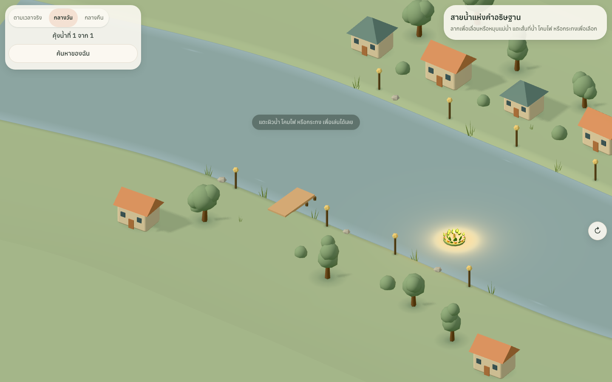 | 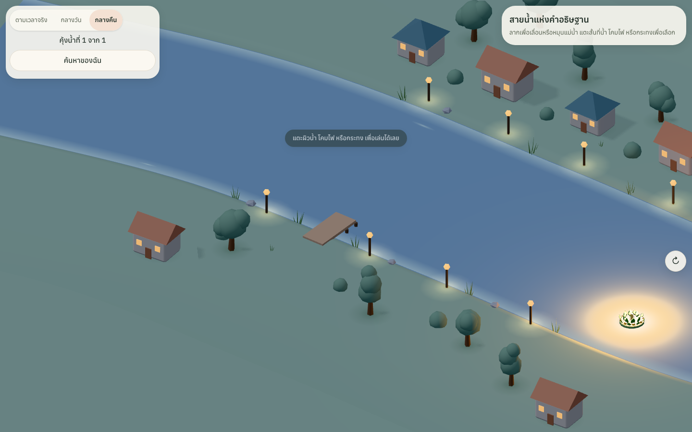 |
| World, 390×844 |   | 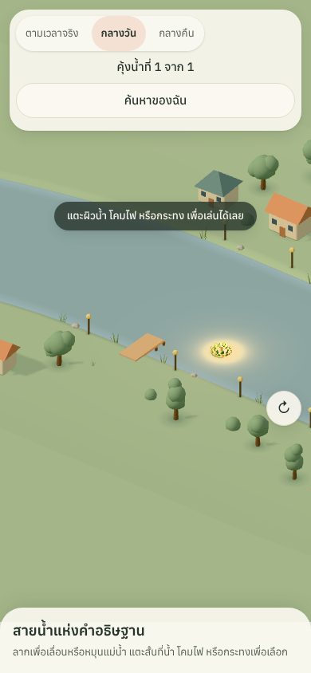 | 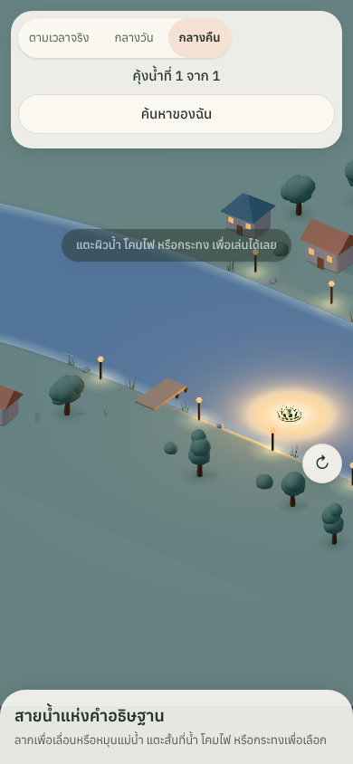 |
| Close-up (wheel zoom) | — | 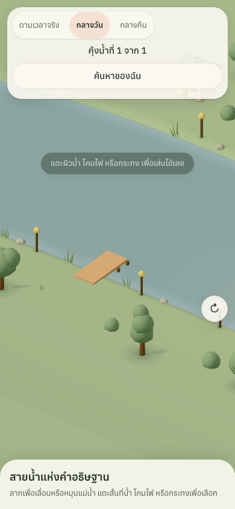 | 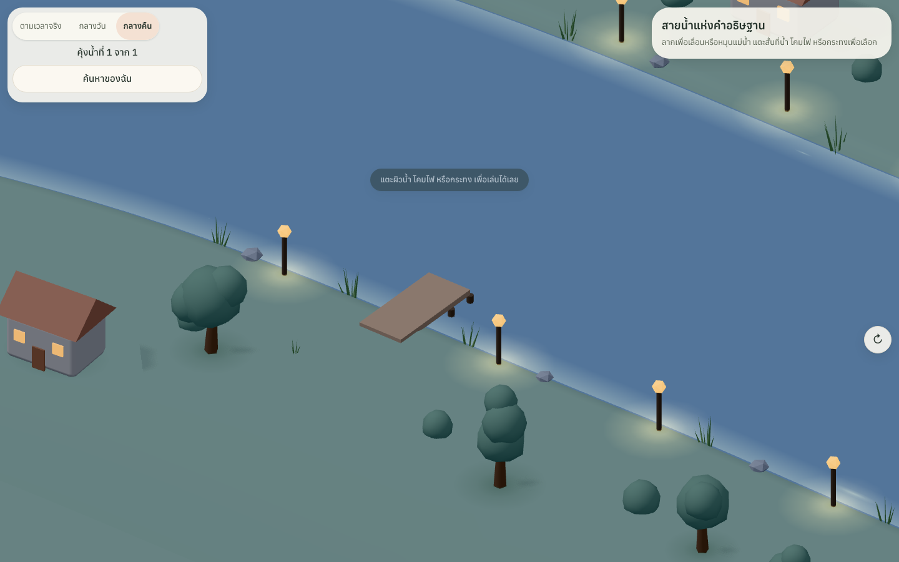 |

## 13. Krathong v3 detail (MFW-69)

Backlog 13.5. Owner (2026-11-25): the leaves and flowers were "only squares and triangles". Every value mirrors
`src/config/krathongModel.config.ts` (config wins) and is **DRAFT**: the owner reviews it from the screenshots below.
Appearance keys, geometry / material keys, river buckets, the assembler and stored data are unchanged, so saved krathongs
render with v3. The customizer, pier and river use the same models (the river at a lighter LOD).

### Shapes

- **Leaf shell** (`LeafShellSpec`, `buildLeafShellMeshData`): a curved, tapered blade, built as a thin closed lens with
  shared edges. Width follows `width · sin(π·t^e)^fullness` (peak at `widestAt`). The spine tilts out from the base and bends
  outward along its length (`baseTiltRad`, `bendRad`). The upper face carries a V fold (the midrib crease, `fold`) and a rounded
  cup (`cup`); the lower face bulges by `thickness`. Petals use the same shell.
- **Leaves**: 8 units of two overlapping layers.
  - Outer leaf: broad, tucked inside the base lip (`OUTER_LEAF_OFFSET`), flaring outward over it.
  - Inner leaf: taller and more upright, on the flower-socket angle, so the two layers overlap around the ring (tested).
  - style_01: pointed (`widestAt` ≈ 0.4); style_02: rounder and broader (`widestAt` 0.55, `fullness` 0.55).
- **Flowers** (`PetalRingSpec`, `buildPetalRingMeshData`): rings of cupped shell petals around a raised yellow centre, each
  petal varied by `PETAL_JITTER` (scale / yaw / tilt).
  - marigold: ruffled, 7 + 5 short rounded petals in two rings;
  - orchid: 3 narrow sepals, 2 broad petals and a cupped lip;
  - lotus: 6 + 4 pointed petals in an upright cup.
- **Bases**: banana trunk with a belly and a rounded lip; bread with a rounded shoulder; lotus = a bowl inside two rings of
  cupped petals.
- **Candle**: rounded lip and two wax drips (no wick: a wick needs a new material and river bucket).
- **Flame**: a larger soft teardrop (height 0.34, radius 0.085; v2 0.26 / 0.065).
- No halo, ring or glow disc was added.

### Levels of detail

| Where | LOD |
|---|---|
| Own krathong (customizer, pier) | full (`KRATHONG_HERO_LOD`) |
| River, HIGH | medium — **PLACEHOLDER** (lead decision; the AC says full; lever `KRATHONG_RIVER_LOD_BY_TIER.HIGH = "full"`) |
| River, MEDIUM | medium |
| River, LOW | low |

- medium: the same leaf shells with 3 columns (outer 2 rows, inner 3 rows); flowers are cupped lobed petal discs; lighter
  lathes for the base, candle, flame and centre.
- low: leaf shells with 2 rows each; fewer lobes and segments.
- Triangles per krathong (worst): full 3 708 / medium 992 / low 808 (guards `KRATHONG_MAX_TRIANGLES_BY_LOD` 3 800 / 1 088 / 900).
  Details and the zone budget per tier: `docs/perf/MFW-69.md`.

### DRAFT list

- Every `LeafShellSpec` / `PetalRingSpec` / lathe value, `OUTER_LEAF_OFFSET`, `PETAL_JITTER`, `CANDLE_DRIP` and the drip
  placement, the flame size.
- The iterated shapes differ from the lead's draft (leaves wider, flatter fold and cup, more rows; outer leaves more upright;
  marigold petals blunter; the lotus base's inner petals moved to the bowl rim); the per-part numbers are in `docs/perf/MFW-69.md` §3.
- `KRATHONG_RIVER_LOD_BY_TIER.HIGH` = "medium" is PLACEHOLDER (owner decides after the phone check).
- Lead guards (not product numbers): `KRATHONG_MAX_TRIANGLES_BY_LOD`, `KRATHONG_FLOWER_CENTRE_MIN_RAISE`.

### Before / after (MFW-69)

Captured on the production build with SwiftShader WebGL, 390×844 at device pixel ratio 4, cropped (CUSTOMIZE zoomed in with
"+" three times; the river zoomed in with the mouse wheel).

| | Before (MFW-48, BASE ce0f2e4) | After |
|---|---|---|
| Own krathong, day | 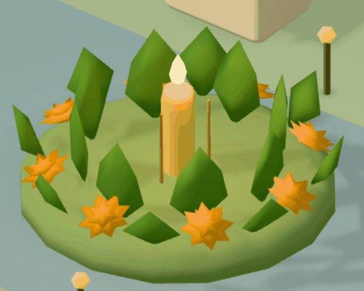 | 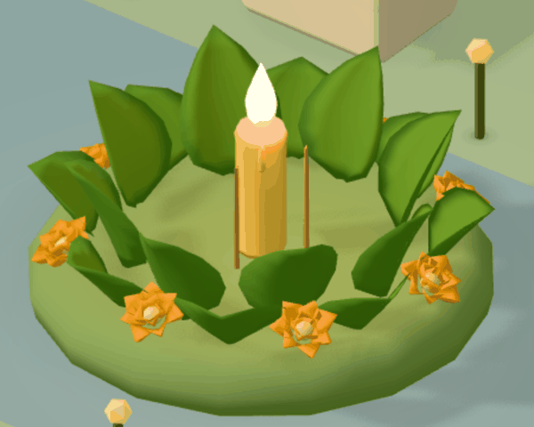 |
| Own krathong, night | 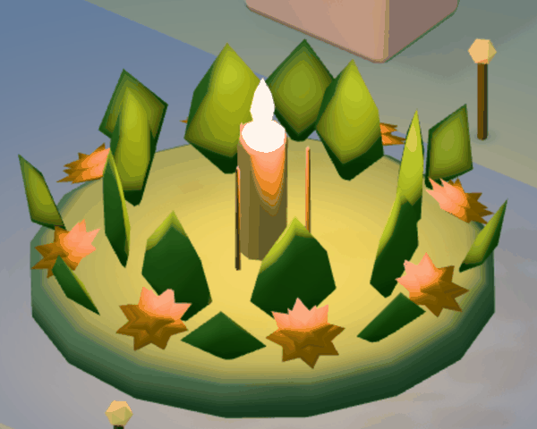 | 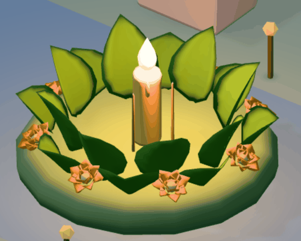 |
| River on HIGH (medium LOD), day | — | 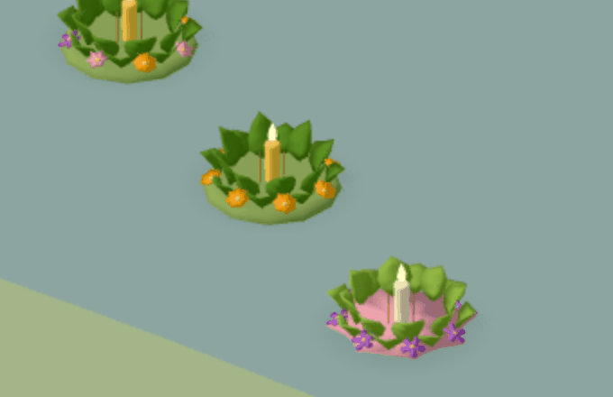 |
| River on HIGH (medium LOD), night | — | 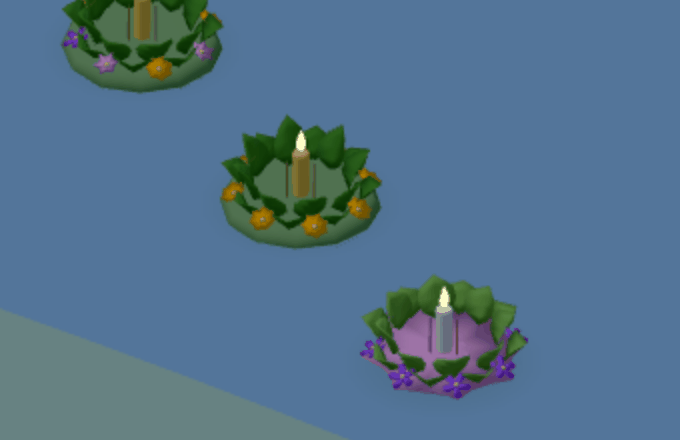 |
| River on LOW (low LOD), day | — | 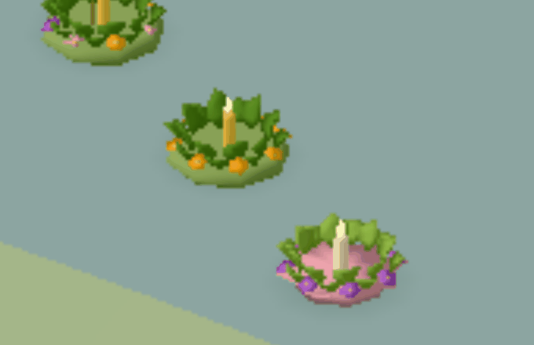 |
| Lotus base, style_02, orchids (own krathong), day | — | 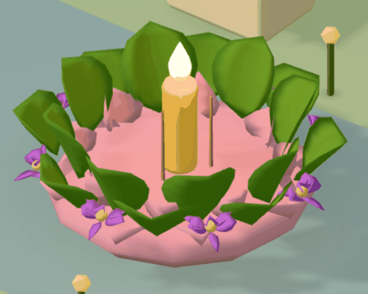 |

## 14. Living riverside (MFW-50, backlog 9.4)

Config: `src/config/events/loyKrathong.life.config.ts` (villager parts, `LOY_KRATHONG_VILLAGERS`, motion, `AMBIENT_MOTES`,
`AMBIENT_MOTE_FAN`, `LANTERN_FLICKER`), `look.config.ts` (`VILLAGER_LOOK`, `AMBIENT_MOTE_LOOK`) and
`performance.config.ts` (`LIVING_WORLD_TIERS`, `LIVING_WORLD_RENDER_BUDGETS`). Pure motion: `src/core/world/villagers.ts`
and `ambientLife.ts`. Config wins over this note.

### 14.1 Villagers

- Simple dark silhouettes (owner, 2026-11-25: "คนอาจจะแค่เป็นเงาๆก็พอ"): a tapered robe-like body (8-sided cylinder), a
  round head (smooth icosahedron) and a conical hat on 3 of 8; about 0.345 world units tall (`VILLAGER_HEIGHT`, two-thirds
  of a house wall). One muted palette colour for every part (`VILLAGER_LOOK.silhouette` = `shadowTint` #40564A); no
  faces, no outfit colours.
- Three InstancedMeshes (bodies, heads, hats) share ONE material and the environment parts' shader program
  (`createInstancedPartMaterial`; the hat's facets are baked into its normals). Plus one soft blob-shadow mesh
  (`DynamicBlobShadows`, radius 0.11) on the village terrace. No real shadows, never culled (constant draw calls).
- They walk the MFW-49 riverside paths (§11.4) through `riversidePathPoseInto` only: `LOY_KRATHONG_VILLAGERS` gives each a
  short segment of path 1 or 2, a fixed `across` in the strip, a speed, a phase, an optional watch stop and a scale.
  Villagers whose segments overlap on one path walk on opposite sides of the strip, so they pass side by side.

### 14.2 Motion

- `villagerPoseInto` is a pure function of (definition, path, wall clock): a ping-pong walk over the segment; on each leg an
  optional stop at `watch.atFraction` for `watch.durationMs`, turned to face the water ("some stop to watch the river").
  One small hop and one side waddle per step (`VILLAGER_MOTION`: step 0.1, hop 0.02, waddle 0.08 rad), derived from the
  distance walked. No physics, no randomness, no stored state: every device shows the same villagers at the same time.
- Reduced motion and LOW: the time-independent STAND pose (at the watch spot, or mid-segment, facing the water), written
  once.
- MFW-60 hook (no tap built here): the stable `villagerId`, `VillagerInstancePlan.villagerIds` (body and head instance →
  id) and `.hatVillagerIds`, and `villagerPoseInto` for the current pose.

### 14.3 Ambient life (lead pick, D3)

- Foliage sway is MFW-70's (§12.4, `RIVER_FOLIAGE_SWAY`); MFW-50's own tree sway was dropped when MFW-70 replaced the
  canopies. The living world adds two kinds:
- Floating light motes: tiny soft points (owner, 2026-11-25: no discs with visible edges, no rings or halos) — the
  vertex-alpha blob fan (alpha 1 at the centre → 0 at the rim) crossed in three planes, so it reads as a soft point from
  every camera yaw without billboarding; pale pollen by DAY, warm fireflies at NIGHT (`AMBIENT_MOTE_LOOK`, one material
  recoloured on a preset switch). They drift on a small circle, bob and pulse slowly over both banks, never over the water.
  One draw call, the blob/fan program.
- Flickering lanterns at NIGHT: the shared lamp-head emissive breathes ±12 % (two slow sines, 1.9 s and 3.1 s). Only the
  existing emissive changes: no halo, no new light. DAY lanterns are off.
- Rejected: chimney smoke (MFW-60 uses it as the house tap reaction; there are no chimneys), ducks / birds (they would move
  over the water where krathongs float, and need new models).

### 14.4 Reduced motion and WCAG 2.3.1

Reduced motion freezes all of it: villagers stand, motes hang at their t = 0 frame, lanterns
get the preset base, and the living world registers no idle redraw. Nothing changes luminance faster than WCAG 2.3.1 allows (≤ 3 cycles
per second): every period is ≥ 1000/3 ms (lanterns 1 900 / 3 100 ms, mote pulse 2 300 ms), checked on the config and by
sampling the maxima per second (`ambientLife.test.ts` W1–W3).

### 14.5 Tiers, idle redraw and budget

| Tier | Villagers (hats) | Walk | Motes | Lantern flicker | Idle redraw (WORLD_EXPLORE only) | Draw calls | Triangles |
|---|---|---|---|---|---|---|---|
| HIGH | 8 (3) | yes | 16 | yes | every 50 ms | 5 | 1 232 |
| MEDIUM | 5 (2) | yes | 10 | yes | every 67 ms | 5 | 712 |
| LOW | 2 (1) | stand | 0 | no | none | 4 | 180 |

- Draw calls = bodies + heads + hats (when any) + villager blobs + motes (when any). Triangles: body 32, head 20, hat 16,
  mote 24 (3 × 8), blob fan 48 / 36 / 30 per tier. Guard: `LIVING_WORLD_RENDER_BUDGETS` 5 / 1 250, 5 / 750, 4 / 200
  (`livingWorldBudget.test.tsx`). Shader programs added: 0.
- ONE idle-redraw source per canvas (`src/components/canvas3d/idleRedraw.ts`, MFW-50 fix round): consumers register the
  interval they want (`useIdleRedraw`); a single timer runs at the smallest registered interval and calls `invalidate()`
  once per tick. No timer while nobody is registered; none in a hidden tab (cleared on `hidden`, re-armed on `visible`). The
  MFW-48 flame flicker registers `FLAME_FLICKER_REDRAW_INTERVAL_MS` (100 / 125 / 150 ms).
- The living world (`AmbientTicker`) registers `LIVING_WORLD_TIERS[tier].idleRedrawIntervalMs` ONLY in the shared world view
  (WORLD_EXPLORE), only while villagers, motes or lanterns move (never for MFW-70's foliage sway alone), and never on LOW or
  under reduced motion. In CUSTOMIZE and RITUAL it registers nothing: villagers, motes, lanterns and the foliage sway advance
  only on frames drawn anyway (the flame cadence), so those views render no extra frame. In the shared world RiverFlow
  already redraws every frame while krathongs drift; the cadence matters only for an empty river.
- Every per-frame writer is allocation-free (`tests/unit/instancing-audit.test.ts`).

### 14.6 Never covering krathongs (AC5)

A layout guarantee, tested (`livingWorldLayout.test.ts`): the camera is orthographic and MFW-57 only pans and turns it
about +Y, so a point at height H projects onto the water at most H / tan(elevation) away. From any camera yaw, no villager
silhouette (hop, waddle and hat included) or mote reaches the krathong lane band (smallest margin 0.55 world units for
villagers, 1.45 for motes); from the default camera, camera-side villagers and motes stay visually on land (margins 0.12
and 0.69). Every living-world mesh has `NO_RAYCAST` and no handler, so none is in R3F's interaction set: water, lamps and the
MFW-59 krathong tap proxies win unchanged (e2e `living-world.spec.ts`).

### 14.7 Measured numbers (local container, SwiftShader)

BASE = main abf3ee5 (MFW-49). Production build, `?pinTier=1`, 390×844.

- `?perfProbe=1`, HIGH world view (calls / triangles / programs): DAY 87 / 9 378 / 9 → 92 / 10 610 / 9; NIGHT 88 / 9 762 / 9
  → 93 / 10 994 / 9 (+5 calls, +1 232 triangles, no new program).
- FPS (3 s rAF count, medians of 3 alternating rounds; the container load average was 14–25 during the run, so the numbers
  are noisy):

| Tier | CUSTOMIZE BASE → MFW-50 | RITUAL BASE → MFW-50 | WORLD BASE → MFW-50 |
|---|---|---|---|
| HIGH | 9 → 11 | 13 → 13 | 8 → 8 |
| MEDIUM | 24 → 16 | 23 → 15 | 12 → 10 |
| LOW | 30 → 35 | 45 → 40 | 16 → 16 |

  That first version redrew CUSTOMIZE / RITUAL at its own 50 / 67 ms on top of the flame timer, so MEDIUM CUSTOMIZE / RITUAL
  dropped. Fixed (§14.5): one shared idle-redraw timer, and the living world registers only in the shared world view.
- Re-measured after the fix, rebased on MFW-70 (BASE = ce6ad2d), MEDIUM, medians of 3 alternating rounds, load ≈ 6–7:
  CUSTOMIZE 50 → 50, RITUAL 53 → 50, WORLD 28 → 25 fps (BASE → MFW-50). `[perf-audit]` HIGH CUSTOMIZE: 92 calls, 12 182
  triangles, 6 programs; HIGH world one / full zone 47 / 47 calls.

### 14.8 DRAFT values (MFW-50)

`VILLAGER_LOOK`, `AMBIENT_MOTE_LOOK`, `VILLAGER_PARTS`, `VILLAGER_BLOB_SHADOW_RADIUS`, `VILLAGER_MOTION`,
`LOY_KRATHONG_VILLAGERS`, `AMBIENT_MOTES` (radius 0.035 → 0.06 for the soft point), `AMBIENT_MOTE_FAN`,
`LANTERN_FLICKER`, `LIVING_WORLD_TIERS`. Lead guard (not a product number): `LIVING_WORLD_RENDER_BUDGETS`. The walking path
stays invisible.

### 14.9 Before / after (MFW-50)

Production build, SwiftShader WebGL, HIGH tier (pinned), shared world view after release, on MFW-70 (foliage).

| | Before (MFW-70) | After (MFW-50) |
|---|---|---|
| World, 1440×900, day |  | 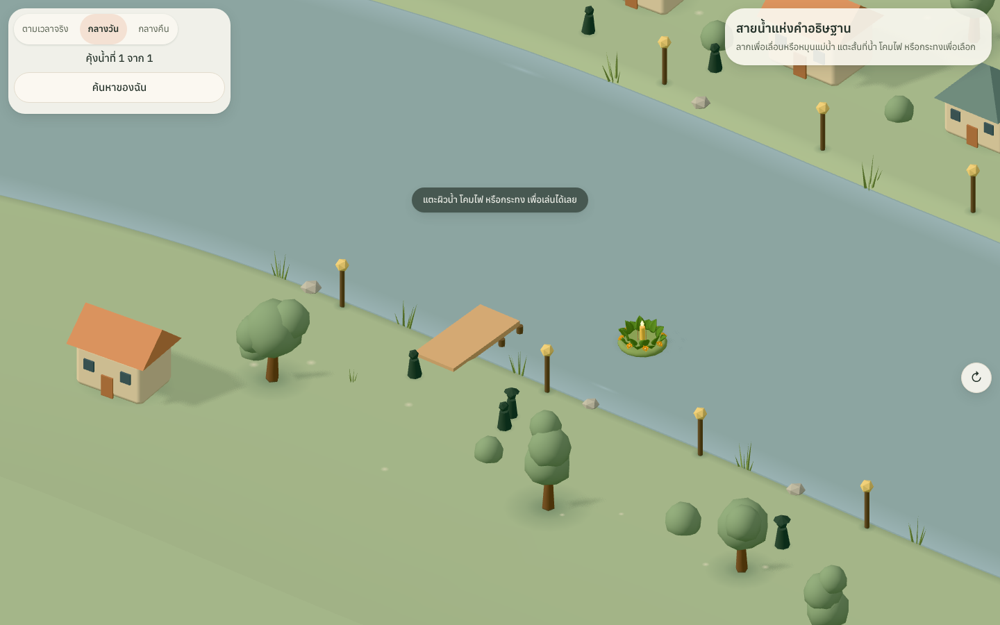 |
| World, 1440×900, night |  | 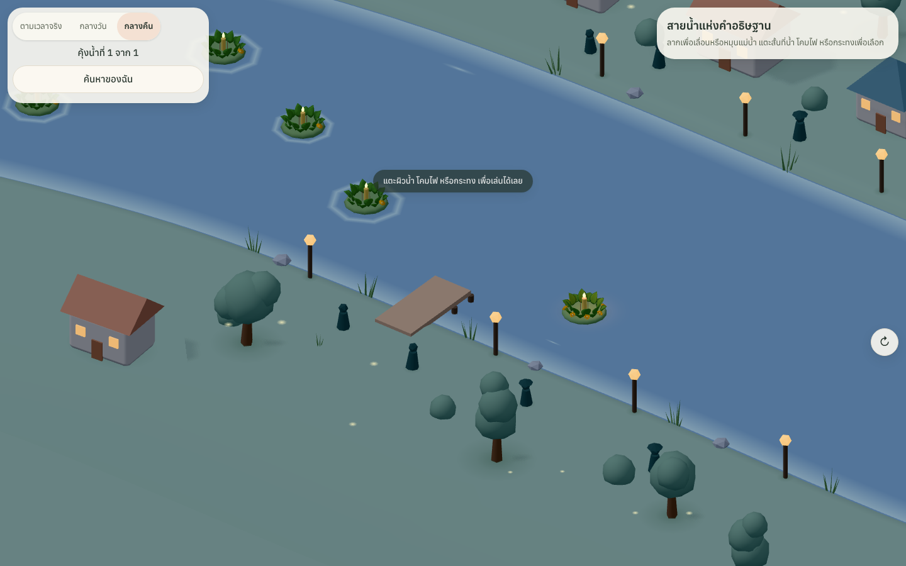 |
| World, 390×844, day |  | 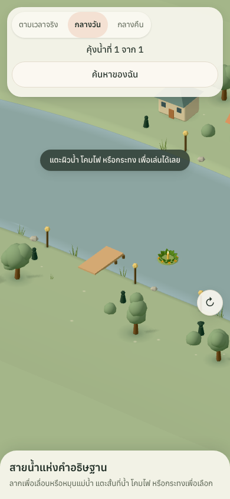 |
| World, 390×844, night |  | 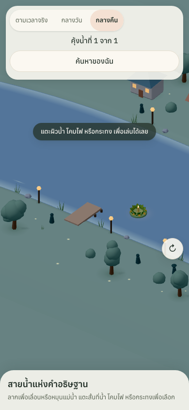 |

## 15. 2D fallback v2 (MFW-51, backlog 9.5) — removed (MFW-71)

The owner removed the 2D fallback ("เอา 2d ออกไปเลย", owner, 2026-11-26; docs/spec/open-questions.md row 46). Only the 3D scene
(tiers HIGH, MEDIUM, LOW) remains; without WebGL the stage shows a short Thai notice instead of the scene (loop decision, not yet
reviewed by the owner). The 2D code, its tests and the 2D day/night path were deleted in MFW-71. The measurements and screenshots in
`screenshots/mfw-51/` stay as history only.

## 16. Scene reactions (MFW-60, backlog 11.4)

Config: `src/config/gimmicks.config.ts` (`SCENE_TAP_REACTIONS`, looks and timings) and `performance.config.ts`
(`EFFECT_POOL_CAPS`, `FIREWORK_SPARKS_PER_BURST`). Curves: `src/core/effects/reactionCurves.ts` and `sceneNudges.ts`. Config
wins over this note. Owner decisions (2026-11-25, open questions 35 and 41): "อยาก interact อะไรก็ได้เลย" (anything in the
scene can be interacted with) and "กดท้องฟ้าแล้วมีการจุดพลุ" (tapping the sky launches a firework); natural feedback, no rings,
halos or yellow discs (MFW-67). Everything else below is a loop decision, not yet reviewed by the owner. This PR is slice 1;
chimney smoke, a few falling leaves and a villager wave are slice 2 (MFW-72, backlog 11.6). Slice 2 shipped in §18.

### 16.1 Registry: one reaction per object type

| Type (tap target) | Reaction (`data-last-gimmick`) | Normal | Reduced motion | LOW |
|---|---|---|---|---|
| house (prop proxy) | windows light up (`house-lights`) | additive warm (#FFB347) skin over both windows, 1.35× the pane, saturating to a bright pane by DAY and NIGHT: attack 120 ms, steady hold, release 700 ms, 2.4 s in all; no flicker | same, no bounce (it never bounces) | same, 1 house at a time |
| tree (prop proxy) | crown shakes (`tree-shake`) | extra decaying shear on the clumps, same pivot / wind axis as the MFW-70 sway, 1.8 s | steady 1.12× size-up for 0.7 s | shake along `TAP_SHAKE_WIND` (no sway on LOW) |
| bush, reed (prop proxy) | shake (`bush-shake`, `reed-shake`) | as the tree, 1.6 / 1.5 s, stronger shear | 1.14× / 1.16× size-up | as HIGH |
| rock (prop proxy) | bounce (`rock-bounce`) | `GIMMICK_BOUNCE` (the lamp / krathong bounce) | 1.12× size-up | as HIGH |
| pier (deck and piles) | deck bounce (`pier-bounce`) | the bounce at amplitude 0.04 | 1.03× size-up | as HIGH |
| villager (proxy that follows it) | hop (`villager-hop`) | one 0.12 × scale hop in 420 ms; its blob shadow stays down | 1.1× size-up | as HIGH (standing villagers hop too) |
| lamp (proxy over the whole post + head, or the head) | light-up + sky lantern (`lamp-glow`) | the MFW-28 glow, plus a sky lantern (โคมลอย) rising from the head | glow steady; lantern static 0.8 above the head for 1.6 s | 1 lantern at a time |
| water | ripple (`ripple`) | unchanged (MFW-28) | unchanged | unchanged |
| krathong | inspect popup + mark cue (`inspect`) | unchanged (MFW-30 / MFW-67) | unchanged | unchanged |
| sky = bare land | firework (`firework`) | shell rises 2.6 world units, 32 sparks burst into a round ~1.3-radius ball, then fall and shrink | static starburst for 0.9 s | 12 sparks, 1 burst at a time |

A prop tap neither selects anything nor moves the camera (like the water tap since MFW-69). The first-visit hint (`SceneTapHint`)
now reads "แตะอะไรก็ได้ในฉาก เพื่อเล่นได้เลย" (DRAFT); the 2D hint no longer exists (MFW-71).

### 16.2 "Sky"

The camera looks down at about 33.5° and MFW-68 frames the scene so that no background pixel is visible, so the view has no sky.
A short tap on the ground or a bank that no tap proxy claims is the "sky" tap: a firework is launched from that point (at the
village terrace height, `bankTopY`) and bursts `FIREWORK_LOOK.burstHeight` above it. No `onPointerMissed` handler.

### 16.3 Who takes a tap

Pure helpers in `src/components/canvas3d/effects/riverHitPick.ts`; R3F calls handlers nearest first until one stops the event.

1. River-krathong and lamp proxies (MFW-59) beat everything. Since the MFW-60 polish the lamp proxy is centred halfway up the
   lamp and covers the whole post and head (`lampTapProxyPlacement`; stretched vertically only if a taller lamp needs it), so a
   tap on the post lights the lamp instead of launching a firework.
2. Prop proxies (`scene-prop-tap-<kind>-<index>`: house, tree, bush, reed, rock, villager) take the tap unless (a) a river or
   lamp proxy is on the ray, or (b) the nearest real surface on the ray is the water and the ray misses the prop's body sphere:
   the river keeps its taps (backlog story 9-4 AC5). Proxies are ≥ `MIN_TOUCH_TARGET_PX` icosahedra
   (`propTapProxyRadius`), drawn never (`visible={false}`), derived from the layout (`buildPropTapTargets`, stable kind + index;
   villagers: `villagerId`), so MFW-58 can offset them per river stretch.
3. Pier deck and piles take the tap unless a river or lamp proxy is on the ray.
4. Water: unchanged (defers only to river and lamp proxies).
5. Ground and banks: the sky tap, unless any tap proxy is on the ray.

Every handler first checks `isTapClick` (a drag, R3F `delta > DRAG_START_DISTANCE_PX`, fires nothing). Proxies and the land / pier
handlers exist only in WORLD_EXPLORE; CUSTOMIZE and RITUAL_RELEASE keep their raycast set.

### 16.4 Pools, frames and programs

- Four new `EffectKind`s in `ObjectPoolManager` (created once per tier caps in `ToyNightScene`, shared with the nudge consumers):

  | Tier | ripple | glow | nudge | windowGlow | firework | skyLantern | sparks / burst |
  |---|---|---|---|---|---|---|---|
  | HIGH | 8 | 6 | 8 | 3 | 3 | 4 | 32 |
  | MEDIUM | 6 | 4 | 6 | 2 | 2 | 3 | 24 |
  | LOW | 3 | 2 | 4 | 1 | 1 | 1 | 12 |

- One InstancedMesh per kind (window glows, fireworks, sky lanterns), sized by the cap, created once per cap and disposed on a
  cap change and on unmount; invisible (no draw call) while idle. A full pool recycles the oldest entry.
- The nudge has no mesh of its own: the owner of each mesh writes it (foliage `writeFoliageSwayAndShake`, `PropNudges` for rocks
  and the pier deck, `writeVillagerInstances` for villagers), plus one tail frame that restores the rest pose. Only
  `SceneEffects` calls `invalidate()`: while any effect or nudge runs, plus one frame after a nudge ends. Nothing registers an
  idle redraw. Every per-frame writer allocates nothing (`tests/unit/instancing-audit.test.ts`).
- Every effect material comes from `setupEffectMesh` (unlit, transparent, no depth write, not tone mapped, instance colours):
  the program of the ripple and lamp glow. Fireworks and lanterns use `NormalBlending` and fade by shrinking (no additive
  halo); only ripples, lamp glows and window glows are additive skins. No `RingGeometry` was added.
- Each firework spark is a head and a smaller tail nearer the centre, so the burst reads as radial streaks; the rising shell
  has two trail dots. A sky lantern is a warm six-sided paper lantern with a pale flame dot under its opening.

### 16.5 WCAG 2.3.1

- Fireworks: launches closer than `FIREWORK_MIN_LAUNCH_INTERVAL_MS` = 1000 / 3 ms are ignored (and not counted), so bursts never
  exceed three per second, in both motion modes.
- Lamp and house glows re-trigger without dipping (`retriggerGlow`: a re-tap keeps the glow at its peak instead of restarting
  the attack from dark; this also fixes the MFW-28 lamp re-tap).
- The window glow has no flicker. Sparks and lanterns shrink to nothing once (no blinking).
- Checked by sampling the curves at 1 ms with a flash counter (`reactionCurves.test.ts` RC8) and the launch limit through
  `SceneEffects` (SE4, RC8). The small-area exception is not relied on.

### 16.6 DRAFT values (owner to confirm)

`TAP_SHAKE_LOOKS` (tree 0.45 / 360 / 600 / 1 800 ms, bush 0.55 / 320 / 550 / 1 600 ms, reed 0.8 / 300 / 500 / 1 500 ms),
`TAP_BOUNCE_LOOKS.pier.amplitude` 0.04, `VILLAGER_TAP_HOP` (0.12, 420 ms), `REDUCED_MOTION_TAP_CUE` (hold 700 ms; tree 1.12,
bush 1.14, reed 1.16, rock 1.12, pier 1.03, villager 1.1), `WINDOW_GLOW_LOOK` (#FFB347, peak 1.6, shell 1.35, 2 400 ms,
release 700 ms), `FIREWORK_LOOK` (rise 750 ms, burst 2 000 ms, height 2.6, radius 1.3, sag 0.6, spark 0.1, tail at 0.6 × 0.65
size, shell 0.08 with 2 trail dots 0.2 apart, reduced-motion hold 900 ms, palette #FFC93C #FF5C9A #4FC8FF #B98CFF #FFF1C4),
`SKY_LANTERN_LOOK` (body 0.18 / 0.135 / 0.3, flame #FFF4C2 × 0.35, rise 3.2, drift 0.6, sway 0.05 / 2 000 ms, 6 000 ms, fade
from 70 %, reduced motion 0.8 above the head for 1 600 ms), the new `EFFECT_POOL_CAPS` columns and `FIREWORK_SPARKS_PER_BURST`
(32 / 24 / 12; the spec's 24 / 16 / 8 did not read as a firework in the screenshots), the hint copy. Polish round (after QA):
the burst spans about 120–170 px across on a 390 × 844 phone (zoom 72.2) and about 340 px at 1440 × 900 (zoom 143); the
lantern is about 26 px wide on the phone (was about 14 px); the tree shake moves 330–1 690 px of a 120 × 140 crop (QA measured
179–306 before).

### 16.7 Measured (production build, SwiftShader, NIGHT, local container)

Probe: the renderer's `info` after two frames. HIGH pinned at 360×640, LOW at 390×844.

| | HIGH calls / triangles / programs | LOW calls / triangles / programs |
|---|---|---|
| Idle, pier view, before (42c5a19) | 91 / 16 766 / 9 | 54 / 8 016 / 5 |
| Idle, pier view, after | 91 / 16 766 / 9 | 54 / 8 016 / 5 |
| During a firework burst, after | 92 / 18 046 / 9 | 55 / 8 496 / 5 |
| Lamp view idle (before = after) | 61 / 13 258 / 9 | 24 / 4 508 / 5 |
| Lamp light-up, before | 62 / 13 278 / 9 | 25 / 4 528 / 5 |
| Lamp light-up + sky lantern, after | 63 / 13 326 / 9 | 26 / 4 576 / 5 |

A firework is one draw call (HIGH 64 spark instances × 20 triangles); the window glow is one draw call of 2 × 12 triangles per
lit house; the lantern adds one draw call of 2 × 24 triangles per lantern. No shader program is added (HIGH compiles 9 with its
shadow-map programs both before and after; LOW stays at 5 ≤ `E2E_MAX_SHADER_PROGRAMS`).

### 16.8 Screenshots (MFW-60)

Production build, SwiftShader, phone 390×844, after the release (pier view).

| | |
|---|---|
| Firework, night | 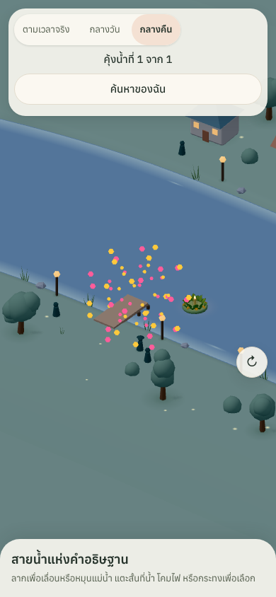 |
| Firework, day | 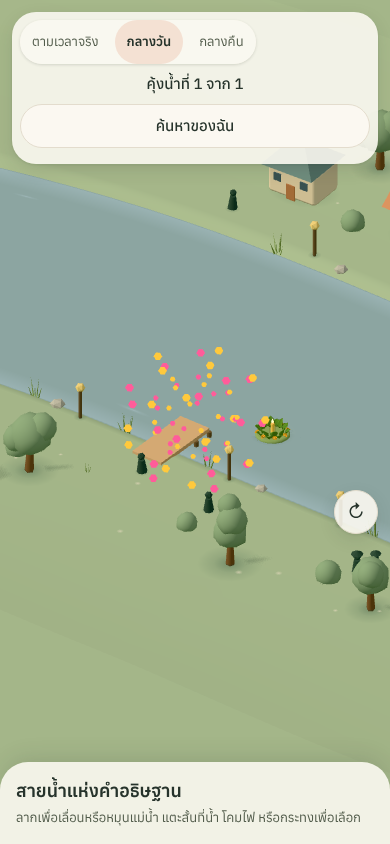 |
| Sky lantern, night | 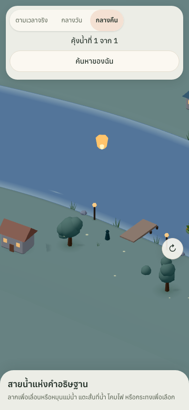 |
| House lights, day | 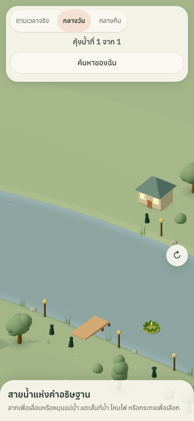 |
| Tree shake, day | 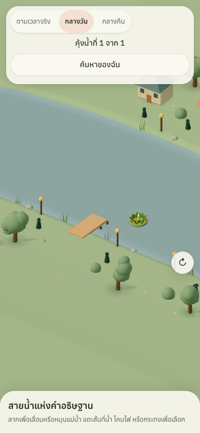 |
| Reduced-motion firework, night | 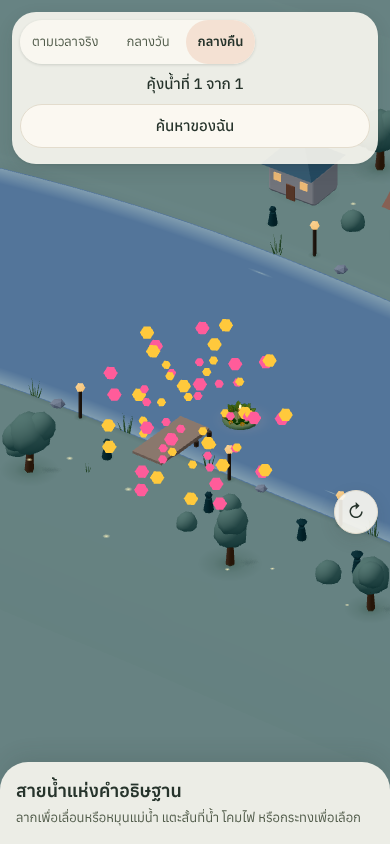 |

## 17. Endless river (MFW-58, backlog 11.2)

The world is an endless chain of identical **stretches**: stretch s is today's river (water, banks, ground, village, foliage,
villagers, motes) translated by s·T, where **T = last − first centreline control point = (24, −1.1)**, |T| ≈ 24.025. The centreline
already joins itself C1 under this translation (end / start tangents differ by ≈ 1.9e-4°), so no control point moved and every stored
`SplinePathCoord` keeps its meaning. `src/core/coordinates/endlessRiverFrame.ts` (three-free) holds the frame;
`endlessSpline.ts` maps a lane pose to stretch s (pose + s·T).

- **Zones per stretch.** zone(s) = wrap(anchor.zoneId + s − anchor.stretchIndex) over N zones (`riverStretches.ts`): with one zone every
  stretch shows zone 1; after the last zone comes zone 1 again (open question 37). `loadZone(z)` (Find My, release, retry) re-anchors so
  the stretch under the camera shows z. Nothing new is persisted.
- **Slots.** 3 persistent stretch copies (`RIVER_STRETCH_RENDER_RADIUS` 1: S − 1, S, S + 1), keyed by s mod 3 and rendered current
  first (`RiverStretch.tsx`). A seam crossing leapfrogs the far slot: it re-plans that slot's krathongs and creates no GPU resource. A slot
  outside the view is hidden per frame (yaw-aware along-axis culling) and its per-frame writers skip their work.
- **Streaming.** The 3D scene keeps the zones of `ZONE_STREAM_LOAD_RADIUS` 2 stretches on each side loaded (≤ 5 zones); farther zones
  are dropped.
- **Ground.** The MFW-68 disc became two strips per stretch (from the banks' outer edge pulled in by `holeMargin` 1 out to a straight
  edge at ±`outerAcross` 30 from the river axis) plus a cap row under the river at each stretch end; copies join exactly at the seams and
  nothing is overdrawn (`sceneCoverage.test.ts` proves no background at every size, pinch, yaw and corridor focus).
- **Camera.** The pan bounds are an endless corridor: unbounded along the river, the MFW-57 rubber band across it. The navigator's ‹ ›
  fly the camera by ±T (instant cut under reduced motion) and its label is the live position indicator.
- **Scenery** is identical in every stretch (DAY and NIGHT alike); seeded variation is a follow-up. With 2+ zones a krathong that drifts
  past its stretch end wraps to its stretch start (no fade).

Screenshots (production build, SwiftShader, `screenshots/mfw-58/`): seam between two stretches (desktop DAY, phone DAY), stretch 1 at
NIGHT, the navigator after a jump, Find My after travelling two stretches (desktop DAY, phone NIGHT).

| | |
|---|---|
| Seam, desktop, day | 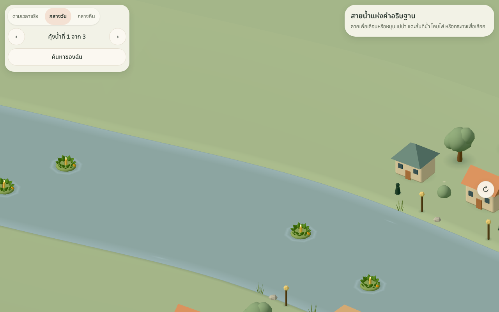 |
| Stretch 1, desktop, night | 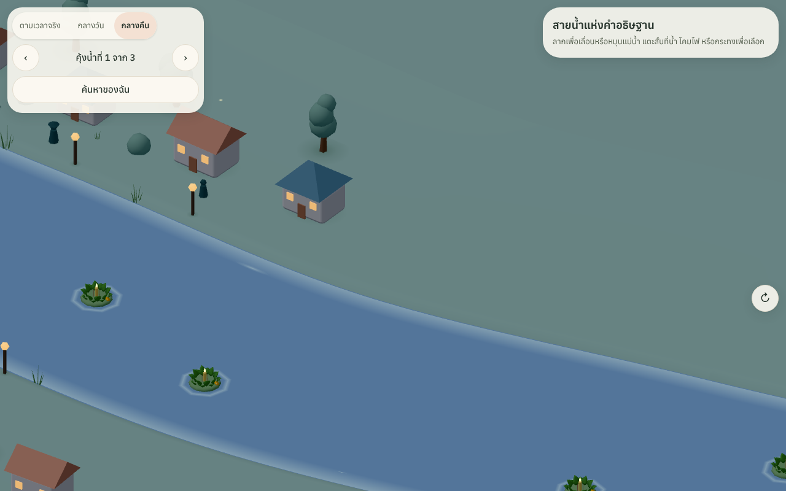 |
| Find My after travel, desktop, day | 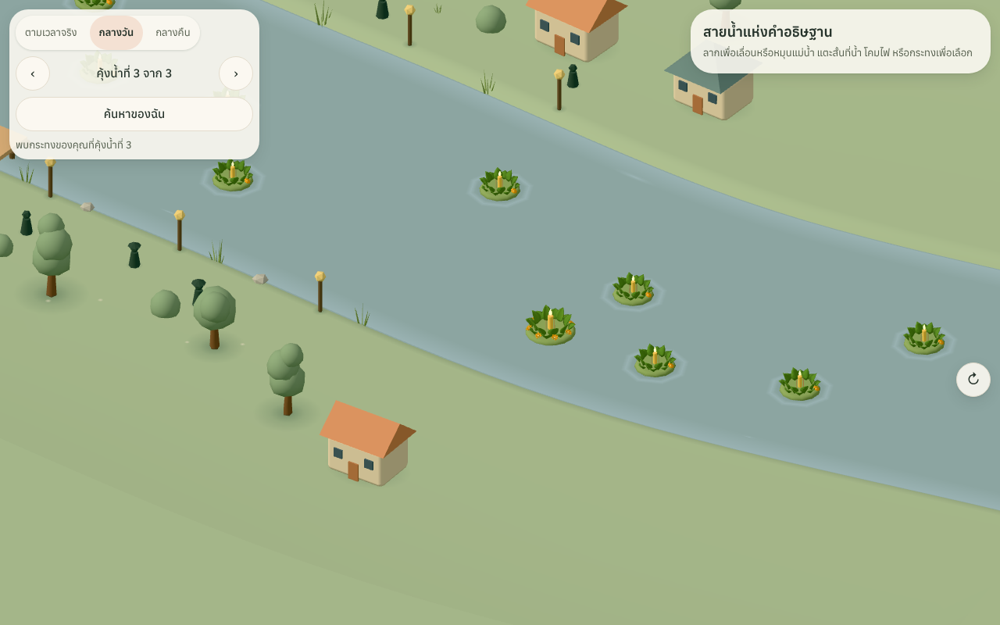 |
| Seam, phone, day | 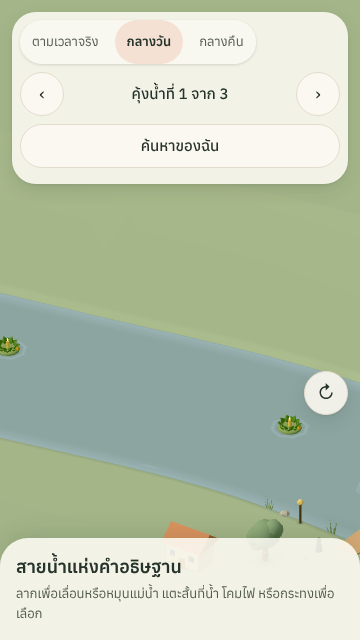 |
| Navigator next, phone, night | 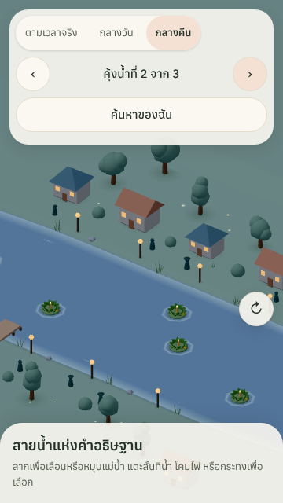 |
| Find My after travel, phone, night | 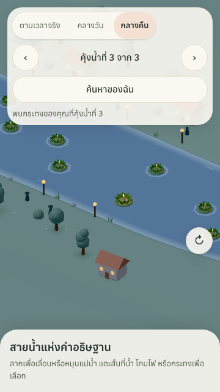 |

## 18. Scene reactions part 2 (MFW-72, backlog 11.6)

Config: `CHIMNEY_SMOKE_LOOK` and `FALLING_LEAF_LOOK` in `src/config/gimmicks.config.ts`; `EFFECT_POOL_CAPS` (columns `chimneySmoke`,
`fallingLeaves`), `CHIMNEY_SMOKE_PUFFS_PER_TAP`, `FALLING_LEAVES_PER_TAP` and `FALLING_LEAF_SLOTS` in `performance.config.ts`. Curves:
`writeSmokePuffAt`, `writeSmokeDriftInto` and `writeFallingLeafAt` in `src/core/effects/reactionCurves.ts`; anchors (built once from the
layout): `src/components/canvas3d/effects/sceneEffectAnchors.ts`. Config wins over this note. Owner decision (open question 35,
2026-11-25, quoted from the row): "house lights + chimney smoke, tree shake, villager wave, sky lantern (โคมลอย), and tapping the sky
launches fireworks". Keeping the MFW-60 hop instead of a wave is a loop decision (D2, AC3 lets the lead decide), not an owner one.
Everything below is a loop decision, not yet reviewed by the owner; every number is DRAFT (docs/follow-ups.md, MFW-72).

### 18.1 Registry rows added in slice 2

| Type | `data-last-gimmick` | Normal | Reduced motion | LOW |
|---|---|---|---|---|
| house | `house-lights` (unchanged) | the §16 window light-up **plus** a smoke plume: 6 soft round puffs leave the roof top one every 140 ms, billow 2.2 world units along a drift chosen at tap time (toward the middle of the screen, D11), rise 0.25, wobble, grow from radius 0.16 to 0.38 and shrink to nothing over the last 30 % of their 1.8 s life (2.5 s in all) | the window light-up only (the instant state); no smoke | 3 puffs, 1 smoke at a time |
| tree | `tree-shake` (unchanged) | the §16 shake **plus** 8 orange-gold / russet leaves (the MFW-69 leaf shell, 0.4 world units long) drop from under the crown one every 140 ms, flutter down for 1.6 s pitched up 1.35 rad (± 0.3) so the face shows, spinning, swaying and drifting downwind, lie flat on the bank 1.2 s and shrink away in 0.5 s | the 1.12× size-up only; no leaves | 3 leaves, 1 fall at a time |
| villager | `villager-hop` (unchanged) | keeps the MFW-60 hop (D2) | 1.1× size-up | as HIGH |

A re-tap on the same house / tree (same stretch) while its smoke is still emitting / its leaves are still in the air is absorbed (no
stacked identical paths); later taps start a new smoke / fall up to the pool cap (a full pool recycles the oldest).

### 18.2 Pools and per-tap counts (DRAFT)

| | HIGH | MEDIUM | LOW |
|---|---|---|---|
| `EFFECT_POOL_CAPS.chimneySmoke` (concurrent smokes) | 3 | 2 | 1 |
| `EFFECT_POOL_CAPS.fallingLeaves` (concurrent leaf falls) | 3 | 2 | 1 |
| `CHIMNEY_SMOKE_PUFFS_PER_TAP` | 6 | 5 | 3 |
| `FALLING_LEAVES_PER_TAP` | 8 | 6 | 3 |

One InstancedMesh per kind and canvas (capacity = cap × per-tap count), created per cap, disposed on a cap change and on unmount,
invisible (no draw call) while idle. The entries carry the house / tree layout index, the tapped stretch and (smoke) the tap-time drift;
the writer adds s·T (the MFW-58 path of the window glow), so hidden stretch slots write nothing. Both meshes use the one effect material
setup with NormalBlending (no new shader program, no ring, no halo; they fade by shrinking). Puff = icosahedron detail 1 (80 triangles,
a round outline); leaf = `buildLeafShellMeshData(FALLING_LEAF_LOOK.shell)` (24 triangles). Same geometry on every tier; LOW is cheaper
by count and cap. The demand frameloop is kept alive only while a smoke or a fall runs.

### 18.3 Decisions

- **D1 No chimney.** The smoke leaves the roof top centre (pyramid apex / gable ridge middle) + 0.04; AC1 allows "from the roof".
  No house-model change, no extra draw call or triangle, `ENVIRONMENT_RENDER_BUDGETS` untouched. A chimney box is a follow-up option.
- **D2 Villager keeps the hop** (loop decision). `VILLAGER_PARTS` (body / head / hat) has no arm. Estimate, not measured: at 390×844 a
  villager is ≈ 25 px tall, so an arm in proportion would be ≈ 9 × 2 px, below what MFW-60 QA found readable; a body tilt reads as the
  walking waddle. A wave would need a new instanced part, a mesh per slot and MFW-50 writer / budget changes.
- **D6 Reduced motion** (invariant F): neither effect starts and running ones are released; the instant state is MFW-60's (window
  glow, size-up cue). **D7** a re-tap while emitting is absorbed. **D8** leaf landing heights come from the bank profile (the farthest
  tree stands on the bank slope; no leaf lands in the river).
- **D11 Drift toward the middle of the screen** (fix round, QA): at the default framing after release the house nearest the top card
  has its roof under the card, so a column rising straight up was hidden. At tap time the smoke origin is projected with the scene
  camera and the drift points from it toward the screen centre (`writeSmokeDriftInto`; its toward-viewer part is divided by
  sin(camera elevation), so equal drift reads as equal screen distance). A house high on the screen puffs toward the viewer (down the
  screen), one at a side edge puffs inward. The plume is low and wide: rise 0.25 instead of a 1.8 column. Computed once per tap from one
  reused scratch vector; no per-frame or per-tap allocation; no camera (tests) → `TAP_SHAKE_WIND`.
- **Leaves** (fix round, QA): a flat 0.26 leaf read as 8–12 px flecks. The leaf is now 0.4 long and pitched up while it falls, so its
  face shows. It lies flat once it lands.
- Colours per light preset (the effect program is unlit): smoke DAY #F5F2EA / #E3DED3, NIGHT #AEB5CB / #959DB6; leaves DAY #E39A2C /
  #C2582A, NIGHT #D2A24E / #C07A45 (contrast with the DAY grass).

### 18.4 Measured (production build, SwiftShader, default framing after release, no pan)

Frames are taken with the page clock paused at tap + t, every 100 ms. The card is the `[data-overlay-slot="top"]` bounding box.

- **Smoke, 390×844.** The only tappable house is the one nearest the top card: its proxy pokes out under the card, and the smoke origin
  is at y 137 against a card bottom of 184. At peak area (t = 1.2 s) 89 % of the plume's area is outside the card, DAY and NIGHT. The
  first pass measured 0 %. The largest puff is 52 px across and the plume spans 72 × 101 px.
- **Smoke, 360×640.** No house is tappable at this default framing.
- **Smoke, 1440×900.** Every tappable house reaches 100 % outside the top card at peak. The two houses near the top edge are partly
  under the right-hand panel (67–100 % outside both the card and the panel). The largest puff is 102 px across.
- **Leaves.** The projected silhouette length (largest distance between projected leaf vertices) while all leaves are in the air:
  - 390×844: median 24.6 px, p25 20.1 px, max 28.8 px (the first pass's 18.8 px was a max).
  - 360×640: median 22.4 px, p25 18.7 px.
  - 8 leaves per fall on HIGH. DAY and NIGHT give the same lengths.

Draw calls, single samples (calls vary by a few between samples with the stretch culling and the krathongs in view; read the
same-sample deltas):

| | calls | triangles | programs |
|---|---|---|---|
| HIGH 360×640 pinned, idle → during smoke | 100 → 102 | 19 896 → 20 240 | 9 → 9 |
| HIGH, idle → during leaves | 100 → 101 | 19 896 → 20 016 | 9 → 9 |
| LOW 390×844, idle → during smoke (single sample) | 62 → 64 | 9 758 → 10 022 | 5 → 5 |

The smoke adds 1 call (+ the window glow's 1), the leaves 1. No program is added: HIGH also compiles the shadow programs, and LOW
stays ≤ `E2E_MAX_SHADER_PROGRAMS` 8.

Screenshots (`screenshots/mfw-72/`, default framing after release, no pan):

| | |
|---|---|
| House smoke, phone 390×844, day (1.2 s) | 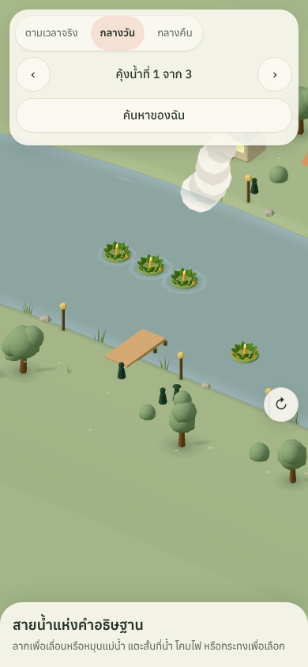 |
| House smoke, phone 390×844, night (1.2 s) | 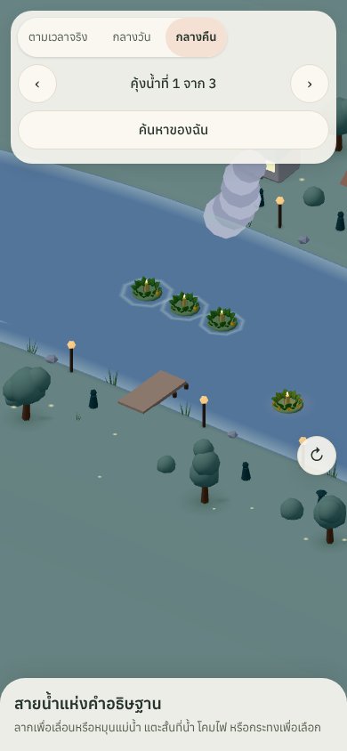 |
| House smoke, desktop 1440×900, day (0.9 s) | 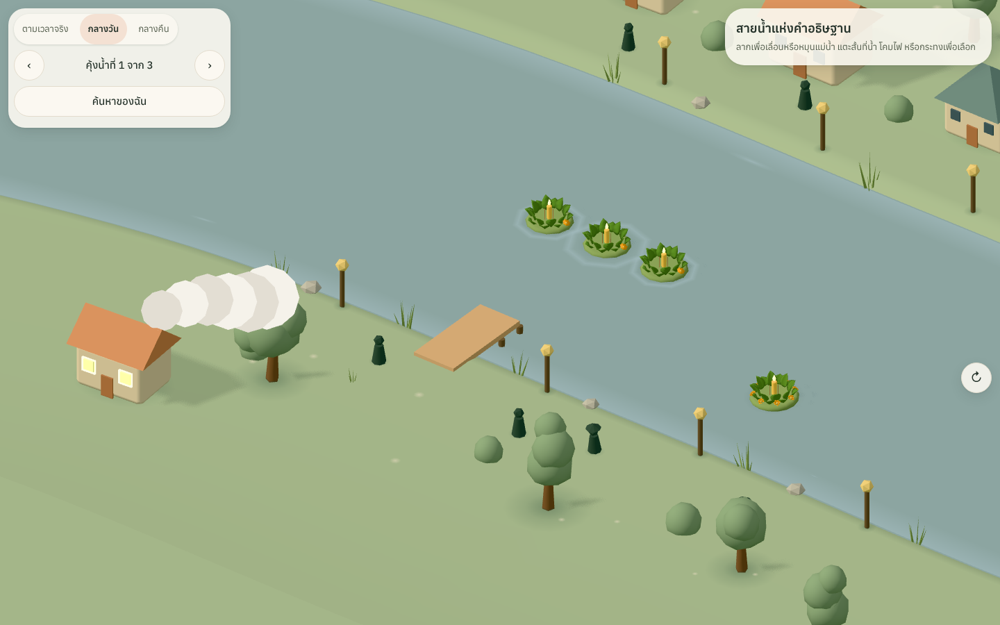 |
| Falling leaves, phone, day (0.9 s) | 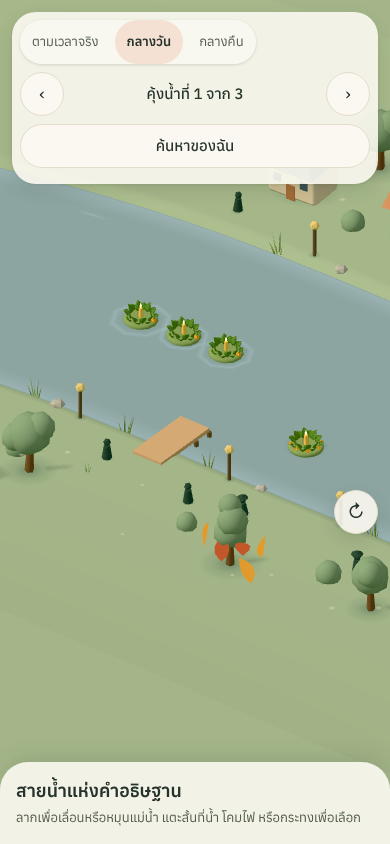 |
| Falling leaves, phone, night (0.9 s) | 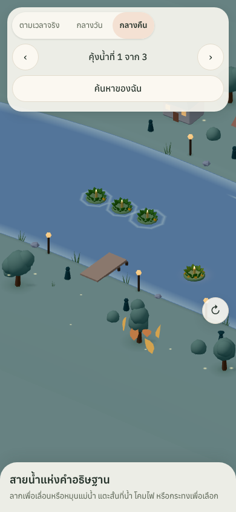 |
| Reduced motion house tap, phone, night (windows lit, no smoke) | 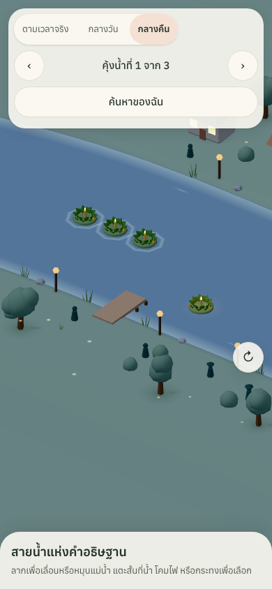 |

### 18.5 Smoke from the chimney, canopy-coloured leaves (MFW-84)

Owner (2026-11-27): "กดบ้าน ควันมันควรลอยขึ้นข้างบนจางๆไม่เยอะมาก ไม่ใช่ลงล่าง" and "กดต้นไม้ใบควรเล็กกว่านี้และเป็นสีเดียวกับต้นไม้". This section
replaces D1 and D11 of §18.3, the smoke and leaf rows of §18.1 and the puff counts of §18.2. Every number is DRAFT (loop decision sized
from the owner's words; docs/follow-ups.md, MFW-84).

**Why the smoke moved down.** D11 aimed the smoke's horizontal drift at the middle of the screen. Every house sits in the upper part of
the default framing, so the drift pointed toward the viewer, which is down the screen. The drift was long (2.2 / max(sin elevation,
0.3) ≈ 4 world units) against a rise of only 0.25, and the wobble ran across the drift (again toward / away from the viewer). The plume
slid down the screen. No gravity, sign or pooled-transform bug. It also started at the roof-top centre, not at the chimney.

New rules (`CHIMNEY_SMOKE_LOOK`, `HOUSE_CHIMNEY_TOP_LOCAL`, `FALLING_LEAF_LOOK`):

- **Chimney origin.** The smoke leaves the chimney-cap top centre, house-local (−0.2101, 0.7711, 0.1131), measured from the owner
  house shell (the lite shell keeps the same cap), through the house yaw and scale, + 0.04 (`buildHouseSmokeOrigins`).
- **Screen-sideways, downwind drift.** The drift is the camera's horizontal right axis, signed to point downwind (`TAP_SHAKE_WIND`),
  chosen once per tap (`writeSmokeDriftInto`). In the orthographic camera without roll, moving along it never changes the screen y,
  so only the rise moves the smoke vertically. The drift is short (0.25) and the wobble (0.03) runs along the same axis.
- **Linear rise.** Each puff rises 0.8 over its 2.2 s life and grows from radius 0.05 to 0.14, then shrinks to nothing over the last
  40 %. Rise ≥ endRadius / (1 − fadeStartRatio) (0.8 ≥ 0.35), so the centre, the top and the bottom of every puff only go up (unit
  tests RC14, GC6, SE17).
- **Faint, not much.** Material opacity 0.45 on the smoke mesh (a uniform: the same effect program). Puffs per tap 4 / 3 / 2 (HIGH /
  MEDIUM / LOW; was 6 / 5 / 3), one every 300 ms.
- **Leaves.** 0.2 world units long (was 0.4). They are drawn with the tree crown's own lit material
  (`RIVER_FOLIAGE_PARTS.*.leafClump.material`, `LOOK_PALETTE.canopy`; FULL and LIGHT share it), without instance colours, so they have
  the crown's colour under the same lights on every tier and under DAY / NIGHT, and reuse the crown's already compiled program. The
  separate orange / russet leaf palette is gone; the leaves are opaque and still fade by shrinking.
- Pools, caps, `FALLING_LEAVES_PER_TAP`, reduced motion (no smoke, no leaves) and the single effect clock are unchanged.

Screenshots (`screenshots/mfw-84/`, phone 390×844, HIGH, pinned tier, default framing after release, no pan; the house nearest the
middle of the upper bank is tapped, then a tree on the near bank). The spec waits 1.2 s (smoke) / 0.9 s (leaves) after the gimmick
attribute; on SwiftShader the smoke frame lands ≈ 1.9–2.4 s after the tap (measured in the before run), so the first puffs are fading.
Before: the plume has slid down the screen onto the river below the house. After: a faint, small plume rises up and slightly
downwind from the chimney, clear of the top card. The leaves are small and canopy-coloured under DAY and NIGHT (LOW checked too, not
committed: 2 puffs, LIGHT crowns, the leaves match).

| | Before (MFW-72 / MFW-77 code) | After |
|---|---|---|
| House smoke, day | 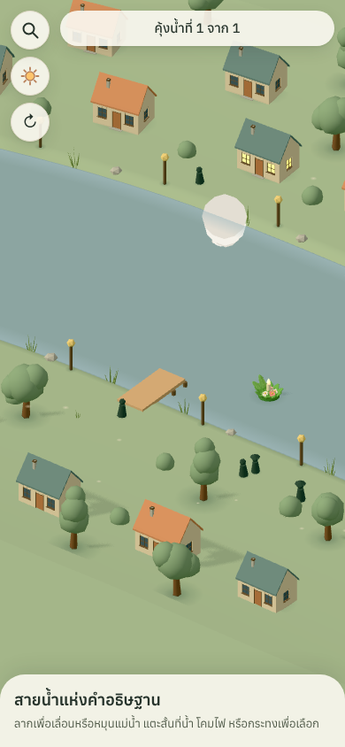 | 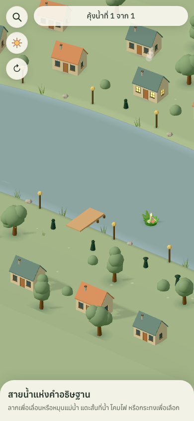 |
| House smoke, night | 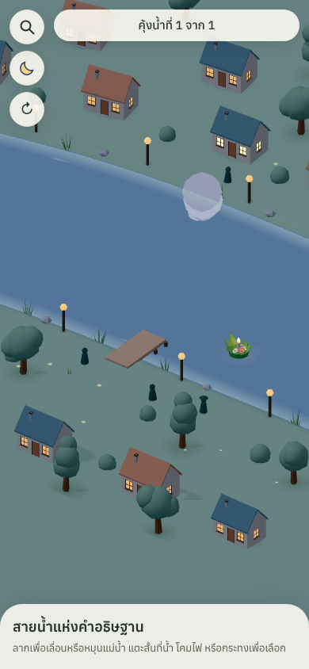 |  |
| Tree leaves, day |  |  |
| Tree leaves, night |  |  |

## 19. Lamp light and sky launch (MFW-75, backlog 14.2)

Config: `LAMP_GLOW_LOOK`, `LAMP_GROUND_LIGHT_LOOK`, `SKY_LAUNCH_SPLIT`, `SKY_LAUNCH_SEED`, `SKY_LAUNCH_GIMMICKS` and
`SKY_LANTERN_LOOK` in `src/config/gimmicks.config.ts`; curve `writeLampLightFrameAt` in `src/core/effects/gimmickCurves.ts`; generator
`createSeededRandom` / `pickSkyLaunch` / `resolveSkyLaunchSeed` in `src/core/effects/seededRandom.ts`. Config wins over this note.
Owner (2026-11-26): "every tap should feel natural". How it is built and every number is a loop decision, not yet reviewed by the owner
(DRAFT values in docs/follow-ups.md, MFW-75).

### 19.1 The lamp switches on and stays lit

- A lamp tap records `lamp-glow`, still selects the lamp and flies to it, and **nothing rises from the lamp** (the sky lantern moved to
  the empty-ground tap). The head skin (§16, `LAMP_GLOW_LOOK.shellScale`, no bounce, no flicker) ramps up over `attackMs` (120 ms) and
  stays lit; a re-tap changes nothing. The glow pool cap (`EFFECT_POOL_CAPS[tier].glow`) bounds the lit lamps: one more lamp recycles
  the oldest lit lamp, which goes dark (D1).
- **Ground light.** A soft warm patch lies around the lamp foot: one vertex-alpha fan per lit lamp (`scene-lamp-ground-lights`, capacity
  = the glow cap), the blob shadow program (`createFanMaterial`, NormalBlending, no new shader program), `LAMP_GROUND_LIGHT_LOOK`
  colour #ffc46b, opacity 0.3, radius 0.6 × lamp scale, falloff exponent 2.5 (softer rim than a blob shadow's 1.6, so there is no
  visible edge), lifted 0.008 above the ground. It grows in with the head (`groundScale = 1 − (1 − u)²`). It is not additive (the MFW-67
  halo probe passes it as is) and there is no light source (no per-fragment cost on lit materials).
- **Reduced motion** (invariant F): the head and the ground light are at full strength from the first frame (no ramp).
- The demand frameloop runs only while a lamp ramps up; a steadily lit lamp costs no frames.
- Screenshots (390×844, the lamp at the centre after its fly-to): `screenshots/mfw-75/after-night-lamp-lit.png`,
  `screenshots/mfw-75/after-day-lamp-lit.png` and desktop 1440×900 `screenshots/mfw-75/after-desktop-night-lamp-lit.png`; before
  (MFW-60: a lantern rose from the lamp) `screenshots/mfw-75/before-night-lamp-tap.png`, `screenshots/mfw-75/before-day-lamp-tap.png`.
  At 390×844 the patch is ≈ 43 px in radius; in neither preset does it read as a ring, a halo or a disc (a faint warm smudge at
  the foot; checked on 4× crops). Owner reviews the look (Open question 2 of the spec).

### 19.2 The empty-ground tap launches a firework or a sky lantern

- The "sky" tap (bare land, §16) starts `skyLaunch`: one draw `u` from the sky launch generator; `u < SKY_LAUNCH_SPLIT.fireworkShare`
  (0.5, DRAFT) → the §16 firework (`firework`), else a sky lantern (`sky-lantern`) that sits on the terrace at the tapped land point
  (`fireworkBaseY` + half its height) and rises with the unchanged `SKY_LANTERN_LOOK`. Both stay pooled with their fixed caps.
- A rate-limited firework (WCAG 2.3.1, `FIREWORK_MIN_LAUNCH_INTERVAL_MS`) spends the draw and starts nothing (no lantern fallback); a tap
  without a land point draws nothing.
- **Seed.** Production seeds the generator (mulberry32) once per SceneEffects mount from `Math.random`, so every visit is a surprise.
  Tests set `window.__MFW_SKY_LAUNCH_SEED__` (the e2e scene probe does) or inject the generator, with `SKY_LAUNCH_SEED` = 8: the
  smallest positive integer whose first two picks are a firework, then a sky lantern (found with a throw-away loop; pinned by
  `gimmicks.config.test.ts`). Screenshot: `screenshots/mfw-75/after-night-sky-lantern.png` (the second sky tap of a page).
- Reduced motion: the static variants of §16 (static starburst, static lantern 0.8 above its launch point).

## 20. Fuller village (MFW-77, backlog 14.3)

Owner review 3 (2026-11-26): "อยากให้เพิ่มหมู่บ้านให้เต็มฉากขึ้นหน่อย". Config: placements in
`src/config/events/loyKrathong.river.config.ts` (`LOY_KRATHONG_RIVER_ENVIRONMENT`, `LOY_KRATHONG_TREES`,
`LOY_KRATHONG_RIVERSIDE_PLANTS`), tiers and budgets in `src/config/performance.config.ts` (`HOUSE_SHELL_TIERS`,
`ENVIRONMENT_RENDER_BUDGETS`, `HOUSE_MODEL_MAX_TRIANGLES`). Config wins over this note.

### 20.1 Goal

At the default world framing (the camera after the release flight, at the pier tip) both banks read as a village on a phone
(390 × 844, also 360 × 640) and on a desktop (1440 × 900), DAY and NIGHT, in the area outside the HUD column, the top pill and
the bottom (phone) or top-right (desktop) card. Every stretch copy of the endless river (§17) draws the same layout, so the
village repeats per stretch. Only existing part kinds are added (houses, trees, bushes, rocks, lamps, reeds), every one on its
existing `InstancedMesh`.

### 20.2 Placements (DRAFT, owner review from the PR screenshots)

Appended at the end of each list (every index-based reference — tap targets, smoke, leaf anchors, lamp indices, e2e probes —
stays stable). Houses 7–15 (setback = world units from the water edge; yaw π = front to the camera):

| progress | side | setback | scale | yawOffsetRad | roof |
|---|---|---|---|---|---|
| 0.13 | -1 | 1.45 | 1.05 | 0 | pyramid |
| 0.22 | -1 | 1.45 | 1 | 0 | gable |
| 0.175 | -1 | 3.2 | 0.95 | 0 | gable |
| 0.265 | -1 | 3.2 | 1 | 0 | pyramid |
| 0.22 | 1 | 2.6 | 1 | π | pyramid |
| 0.265 | 1 | 3.8 | 0.95 | π | gable |
| 0.43 | 1 | 3.5 | 1 | π | pyramid |
| 0.525 | 1 | 3.5 | 1.05 | π | gable |
| 0.615 | 1 | 3.6 | 0.95 | π | pyramid |

Trees 9–13:

| progress | side | setback | scale | yawOffsetRad | shape |
|---|---|---|---|---|---|
| 0.22 | -1 | 4.3 | 1 | 0.9 | round |
| 0.305 | -1 | 4.0 | 1.05 | 3.7 | tall |
| 0.155 | 1 | 1.8 | 1 | 2.2 | round |
| 0.475 | 1 | 4.4 | 1.1 | 4.6 | tall |
| 0.57 | 1 | 4.5 | 1 | 0.3 | round |

Other props (progress / side / setback / scale / yawOffsetRad):

- Bushes 6–9: 0.175 / -1 / 1.1 / 1 / 0.5 · 0.265 / -1 / 1.1 / 0.9 / 2.0 · 0.24 / 1 / 1.45 / 1 / 3.6 · 0.475 / 1 / 3.2 / 0.95 / 5.3.
- Rocks 4–5: 0.24 / -1 / 0.12 / 1 / 0 · 0.22 / 1 / 0.12 / 0.95 / 0.
- Lamps 8–11 (setback 0.2, scale 1, yaw 0): 0.19 side -1 · 0.27 side -1 · 0.18 side 1 · 0.26 side 1.
- Riverside reeds 11–12: 0.215 / -1 / 0.05 / 1 / 2.1 · 0.205 / 1 / 0.04 / 1.05 / 4.9.

Totals: houses 7 → **16** (pyramid 8, gable 8; 80 window glasses), trees 9 → 14, bushes 6 → 10, rocks 4 → 6, lamps 8 → 12,
riverside plants 10 → 12, leaf clumps 52 FULL / 38 LIGHT. No house footprint overlaps another house, a tree, a bush, a lamp or a
rock, also against the neighbouring stretch copies (`riverLayout.test.ts` R12); every existing layout guard (paths clear, props on
the banks, no solid prop hides a lane, bases on the bank profile) still holds.

### 20.3 LOW draws a lite house shell (owner decision)

Owner (chat, 2026-11-27): **"LOW ใช้บ้านแบบเบา"**. `HOUSE_SHELL_TIERS` = HIGH `"FULL"`, MEDIUM `"FULL"`, LOW `"LITE"`. The lite
shell is the owner house shell without its trim faces (`HOUSE_MODEL_SPEC.liteDroppedRegions` = `["trim"]`), generated by the
same offline run as the shell (`node scripts/house-model.mjs --source "<path>/House by Poly by Google - 6PGyqELX8M-.glb"`, then
`--check`): **612 → 308** triangles per house, same palette, frame and `centerY`, a box inside the full shell's. Build notes:
`docs/design/models.md` §10f. `RiverEnvironment` passes `houseBodyForTier(tier)` to the one house-body `InstancedPart`; the
lite part (`RIVER_HOUSE_BODY_PARTS.LITE`) shares the full part's material object, so a tier change swaps only the geometry and
adds no draw call and no shader program. Roofs, windows, tap proxies, smoke origins and the stretch extent use the full shell's
box. On LOW the window holes lose their frames; the glass boxes behind them still fill them (lit at NIGHT).

### 20.4 Budgets (stated openly; lead, DRAFT for owner review)

Environment main pass, NIGHT, no river krathongs (`environmentBudget.test.tsx` EB2 pins the measured values):

| Tier | Triangles before | Triangles after | `maxTriangles` | Draw calls (max) |
|---|---|---|---|---|
| HIGH | 12 504 | **23 160** (+10 656) | 12 900 → **23 600** | 19 (21) |
| MEDIUM | 12 144 | **22 584** (+10 440) | 12 450 → **22 950** | 19 (21) |
| LOW | 9 408 | **13 548** (+4 140; 18 412 with the full shell) | 10 500 → **14 700** | 18 (20) |

Each new budget is the old budget plus the measured increase, rounded up to 100 (e.g. MEDIUM 22 950 = 12 450 + 10 440 → +10 500). The budgets are per stretch copy: a frame at a stretch seam draws two copies (estimate, LOW worst seam frame ≈ 2 × 13.5k environment triangles plus the river krathongs). A full house is 872 triangles (shell 612 +
roof 200 + 5 glass boxes) plus one blob shadow fan (48 / 36 / 30). The HIGH shadow pass gains 7 448 caster triangles
(9 × 812 + 5 trunks × 28). The environment goes from about 7 % to about 12 % of a full HIGH frame
(`HIGH_RIVER_KRATHONG_ZONE_MAX_TRIANGLES` 168 960); draw calls, programs and fill rate stay the same.

Options compared (lead):

| Option | HIGH / MEDIUM / LOW triangles | Note |
|---|---|---|
| **Full model on HIGH / MEDIUM, lite shell on LOW (chosen; LOW by the owner)** | 23 160 / 22 584 / **13 548** | Draw calls unchanged; one script run |
| Full model everywhere | 23 160 / 22 584 / 18 412 | First lead plan |
| Lite shell for the new houses on every tier | 20 424 / 19 848 / 15 676 | Mixed detail on desktop; +1 draw call |

perf-audit (SwiftShader, `tests/e2e/perf-audit.spec.ts`), BASE → MFW-77: HIGH `callsOne` 45 → 45, `trianglesOne` 21 180 → 32 700,
`fpsOne` not reported (null) in both runs; LOW `programs` 7 → 7 (≤ `E2E_MAX_SHADER_PROGRAMS` 8), geometries 81 → 81.

### 20.5 Houses at the default framing

`sceneFraming.test.ts` SF1 counts the houses whose body centre projects inside the frame and outside the HUD rectangles
(measured from the MFW-74 screenshots): BASE 1 / 1 / 2 → MFW-77 **6 / 4 / 6** at 390 × 844 / 360 × 640 / 1440 × 900, both banks
in every size (guards: ≥ 6 with both banks on the phone and the desktop, ≥ 4 at 360 × 640).

### 20.6 Screenshots

`docs/design/screenshots/mfw-77/` — default world framing after the release flight, BASE (`before-*`) and MFW-77 (`after-*`):

| View | Tier | Files |
|---|---|---|
| 390 × 844, 1440 × 900, DAY / NIGHT (e2e `world-hud-screenshots.spec.ts` X1: 4 GB, 4 cores) | LOW | `{before,after}-{phone,desktop}-{day,night}.png` |
| The same views at 8 GB, 8 cores | HIGH | `{before,after}-high-{phone,desktop}-{day,night}.png` |
| 360 × 640, DAY / NIGHT (4 GB, 4 cores) | LOW | `{before,after}-small-{day,night}.png` |
| 390 × 844 NIGHT, 1 GB, 1 core (lite shells) | LOW | `after-phone-night-low.png` |

Checked on 4× crops: no gap under any house (the second-row houses on the bank rise included), no house hides a lane, and the
windows are lit at NIGHT in the full and the lite shells.

### 20.7 DRAFT / open for the owner

- The new placements and density (16 houses, staggered second rows).
- The budget raise to 23 600 / 22 950 / 14 700.
- The village still covers progress ≈ 0.13–0.71 of each stretch; the rest stays bare banks while travelling (as at BASE).
- No new prop kind (fences, gardens, rice barns would cost +1 draw call each).

## 21. Water with more depth (MFW-79, backlog 14.5)

Owner review 3 (2026-11-26): "ทำให้คลื่นน้ำดูมีมิติขึ้นอีกนิด". The river gets soft, broad swells that shade the water and drift
downstream with the krathongs; still clay-toy pastel, not realistic water.

### 21.1 Approach

- The water mesh keeps `meshStandardMaterial {...TOY_MATTE_MATERIALS.water}` (roughness 1): no new material, no normal map,
  no custom shader, so **no new shader program on any tier** (normals are not part of the program key).
- Only its **vertex normals** change: `writeWaterWaveNormals` (`src/core/world/waterWaves.ts`) writes a two-train swell field
  into the normal buffer (`createWaterSurfaceGeometry`, dynamic usage). The key and hemisphere lights turn the light-facing
  slopes into soft bands that move with the flow; the existing bank glints stay the sparkle.
- Positions stay flat (y = 0 at `waterSurfaceY`): taps, krathong float height and the overlays at `liftY` are unchanged.
- The water ribbon has 4 vertices across (`LOY_KRATHONG_RIVER_ENVIRONMENT.waterColumns`, technical) so crests can run
  diagonally; rows stay `ribbonSegments` 48. The field is a function of stretch-local position with integer `alongCycles`, so
  every stretch copy computes the same field and the seams are continuous.

### 21.2 Values (DRAFT, owner review from the PR screenshots)

`RIVER_WATER_WAVES` (`src/config/events/loyKrathong.river.config.ts`):

| Train | alongCycles | acrossPerUnit | phase | speedScale | tiltAlong | tiltAcross |
|---|---|---|---|---|---|---|
| 0 | 6 | 0.12 | 0 | 1 | 0.27 | 0.09 |
| 1 | 8 | −0.15 | 0.37 | 1.4 | 0.15 | 0.12 |

Wavelengths ≈ 4.0 / 3.0 world units along the flow. Speed = `RIVER_DRIFT_SPEED_FACTOR × speedScale` (train 0 at the
krathongs' speed, train 1 a little faster, so the pattern changes shape instead of sliding as a rigid image).

**Tuning factor 1.5** (lead allowance: one common factor in [0.75, 1.5] on all four tilts). With the lead's tilts
(0.18 / 0.06, 0.1 / 0.08; max ≈ 17°) the HIGH desktop DAY screenshot showed the swells only barely (water luminance std
3.2 at BASE → 4.8, 0–255 scale); with × 1.5 (max ≈ 25°) they read as soft diagonal bands (std → 6.0). No other value
changed; `acrossPerUnit` is unchanged (no quad-diagonal creases visible on a 2× contrast-stretched crop).

### 21.3 Per tier

| Tier / setting | Swells |
|---|---|
| HIGH, MEDIUM (`WATER_EFFECT_TIERS.waveMotion` true) | drift with the flow, written on every frame the scene already renders (no `invalidate()`); culled stretch copies skip |
| LOW (`waveMotion` false) | static shading, written once at t = 0 (no per-frame upload) |
| Reduced motion (any tier) | still water, written once at t = 0 |

### 21.4 Budget

Water triangles per stretch 96 → 288 (+192). Environment main pass measured 23 352 / 22 776 / 13 740 (HIGH / MEDIUM /
LOW; was 23 160 / 22 584 / 13 548) against the unchanged budgets 23 600 / 22 950 / 14 700. Draw calls unchanged
(19 / 19 / 18). No new program: LOW `programs` 7 in the perf audit (≤ `E2E_MAX_SHADER_PROGRAMS` 8; `environmentPrograms.test.ts` unchanged).

### 21.5 Screenshots

`docs/design/screenshots/mfw-79/` — default world framing after the release flight, BASE (`before-*`) and MFW-79 (`after-*`):

| View | Tier | Files |
|---|---|---|
| 390 × 844, 1440 × 900, DAY / NIGHT (e2e `world-hud-screenshots.spec.ts` X1: 4 GB, 4 cores) | LOW | `{before,after}-{phone,desktop}-{day,night}.png` |
| The same views at 8 GB, 8 cores (`E2E_SCREENSHOT_DEVICE=high`) | HIGH | `{before,after}-high-{phone,desktop}-{day,night}.png` |

The swells are subtle by design ("อีกนิด"): soft diagonal light and shade bands across the river. They read best at HIGH desktop
NIGHT and DAY; on the phone views (a smaller river area) and on LOW (frozen at t = 0) they are fainter. HIGH screenshots catch
the swells at whatever time the frame was taken, so the band positions differ from run to run.

### 21.6 DRAFT / open for the owner

- Q1 — swell look (`RIVER_WATER_WAVES`, tuning factor 1.5): default as shipped; options: stronger or finer ripples (more
  rows → a triangle budget raise), or weaker.
- Q2 — LOW: default static swell shading (the MFW-49 LOW policy); option: moving on LOW too (a normal-buffer upload every
  frame on the weakest devices).
- Q3 — more moving highlights across the middle of the river: default none new (the light-facing swells plus the existing bank
  glints); option: mid-channel glints (≈ 48 triangles each on HIGH, a budget raise).
- Q4 — NIGHT: the moon key light is weaker than the DAY sun, so the swells are fainter at NIGHT mainly on LOW (static, LOW phone NIGHT reads nearly flat), while HIGH NIGHT reads clearly; default accept;
  option: a NIGHT-specific tilt (a preset-aware spec).
