# Minimal UI — design tokens and screens (MFW-55, backlog 10.3)

## 1. Purpose

Owner decision 28 (2026-11-25): the scene fills the screen and the web UI is minimal and beautiful ("ทำ ui เว็บ minimal
สวยๆ"). **The scene is the hero**: overlays are light, translucent where they float over the scene, and carry at most one
primary action per step. The look follows the soft pastel clay look of MFW-47 (`docs/design/loy-krathong-look.md`,
`src/config/look.config.ts`) and the reference image `docs/spec/assets/loy-krathong-look-ref.png`.

**Every value in this document is DRAFT** until the owner signs off on the PR screenshots (§12).

## 2. Where things live

| What | File |
|---|---|
| Design tokens (the single source) | `src/app/globals.css` (`@theme static` block) |
| Class recipes built from the tokens | `src/components/ui/uiClasses.ts` (`UI_CLASSES`, `PRIMARY_ACTION_PROPS`, `UI_GLYPHS`) |
| UI copy added by this card | `src/config/ui.config.ts` (`FLOW_STEP_COPY`, `APP_METADATA_COPY`) |
| Layout slots | `src/components/ui/StageLayout.tsx` (`STAGE_LAYOUT_CLASSES`) |

Tokens are Tailwind v4 theme variables, so each one is both a utility (`bg-veil`, `text-caption`, `rounded-card`,
`shadow-float`, …) and a runtime CSS variable (`var(--spacing-gutter)`). `tests/unit/ui-doc.test.ts` keeps this document
in sync with the CSS; `tests/unit/ui-tokens.test.ts` checks that no other CSS file defines tokens.

## 3. Tokens

Copied verbatim from `src/app/globals.css`:

```css
@theme static {
  /* Colour */
  --color-stage: #D8E4CF;
  --color-paper: #FBF8F1;
  --color-veil: rgb(251 248 241 / 0.9);
  --color-ink: #26332B;
  --color-ink-muted: #525C4B;
  --color-ink-veil: rgb(38 51 43 / 0.8);
  --color-line: #E3DCCD;
  --color-track: #7E7868;
  --color-clay: #9A4A2A;
  --color-clay-strong: #7F3B20;
  --color-clay-soft: #F4E1D3;
  --color-clay-ink: #FFF8EE;
  --color-danger: #8F2A1E;
  --color-danger-soft: #FBE8E3;
  --color-notice: #6B4810;
  --color-notice-soft: #FAF0DA;
  --color-focus: #1E2A22;
  /* Type scale */
  --text-caption: 0.8125rem;
  --text-caption--line-height: 1.25rem;
  --text-body: 0.9375rem;
  --text-body--line-height: 1.5rem;
  --text-input: 1rem;
  --text-input--line-height: 1.5rem;
  --text-title: 1.125rem;
  --text-title--line-height: 1.625rem;
  --text-display: 1.5rem;
  --text-display--line-height: 2rem;
  /* Radius */
  --radius-field: 1rem;
  --radius-card: 1.5rem;
  --radius-sheet: 1.75rem;
  /* Spacing */
  --spacing-gutter: 0.75rem;
  --spacing-card: 1rem;
  /* Shadow */
  --shadow-raised: 0 1px 3px rgb(38 51 43 / 0.16);
  --shadow-float: 0 6px 20px -4px rgb(38 51 43 / 0.18), 0 1px 3px rgb(38 51 43 / 0.08);
  --shadow-sheet: 0 -8px 24px -6px rgb(38 51 43 / 0.16);
  /* Motion */
  --default-transition-duration: 160ms;
  --default-transition-timing-function: cubic-bezier(0.2, 0, 0, 1);
  /* Focus */
  --focus-ring-width: 3px;
  --focus-ring-offset: 2px;
}
```

### Colour

| Token | Value | Use |
|---|---|---|
| `stage` | #D8E4CF | Empty-stage and calm-screen background (= `LOOK_PALETTE.daySky`), so there is no white flash before the scene |
| `paper` | #FBF8F1 | Solid cards (wish dialog, inspect popup) and controls |
| `veil` | paper at 90 % | Translucent HUD surfaces over the scene (top card, bottom sheet / side panel, day/night switch) |
| `ink` | #26332B | Text |
| `ink-muted` | #525C4B | Secondary text (captions, hints, labels in lists) |
| `ink-veil` | ink at 80 % | The tap-hint pill |
| `line` | #E3DCCD | Borders of controls and cards |
| `track` | #7E7868 | Switch track when off |
| `clay` | #9A4A2A | The primary action; selected chip border; festival dates on the calm screen |
| `clay-strong` | #7F3B20 | Primary action hover |
| `clay-soft` | #F4E1D3 | Selected chip / radio fill, hover of secondary controls |
| `clay-ink` | #FFF8EE | Text on clay |
| `danger` / `danger-soft` | #8F2A1E / #FBE8E3 | Moderation and error alerts |
| `notice` / `notice-soft` | #6B4810 / #FAF0DA | The ownership notice |
| `focus` | #1E2A22 | Focus ring |

### Type (font: Anuphan, §4)

| Token | Size / line height | Use |
|---|---|---|
| `text-caption` | 13 px / 20 px | Hints, helper text, status lines, the day/night switch |
| `text-body` | 15 px / 24 px | Body text, buttons, chips, list rows |
| `text-input` | 16 px / 24 px | Text fields (16 px keeps iOS from zooming on focus) |
| `text-title` | 18 px / 26 px | Card and step titles, icon glyphs |
| `text-display` | 24 px / 32 px | The festival name on the calm screen |

### Radius

| Token | Value | Use |
|---|---|---|
| `rounded-field` | 16 px | Fields, list rows, alerts, notices, insets |
| `rounded-card` | 24 px | Floating cards and popups |
| `rounded-sheet` | 28 px | Bottom sheet (top corners) and the side panel |
| `rounded-full` | — | Buttons, chips, the switch (Tailwind built-in) |

### Spacing

| Token | Value | Use |
|---|---|---|
| `gutter` | 12 px | Inset of every floating slot from the screen edge (combined with the safe area) |
| `card` | 16 px | Inner padding of cards, sheets and panels |

### Shadow

| Token | Use |
|---|---|
| `shadow-raised` | Small lift: selected tab segment, switch knob, day/night switch |
| `shadow-float` | Floating cards and popups |
| `shadow-sheet` | The bottom sheet on phones (shadow upward) |

### Motion

`--default-transition-duration: 160ms` with `cubic-bezier(0.2, 0, 0, 1)` is what `transition-colors` uses. Only colour
transitions exist, and only where the component already had one. Under reduced motion every transition and animation is
off (§8).

### Focus

A 3 px solid `--color-focus` outline at a 2 px offset on every native control (`:focus-visible`).

## 4. Font

One Thai-capable web font: **Anuphan**, loaded with `next/font/google` in `src/app/layout.tsx` — subsets `thai` + `latin`,
variable axis (weights used: 400 / 500 / 600), CSS variable `--font-anuphan`, `display: "swap"`, self-hosted by next/font.
`--font-sans` points at it, so every element uses it. `<html lang="th">` (the UI copy is Thai; the English festival name
carries `lang="en"`). DRAFT choice — alternatives for the owner: Noto Sans Thai Looped (looped, more traditional), IBM Plex
Sans Thai, Mitr (rounder, playful).

## 5. Layout slots (`STAGE_LAYOUT_CLASSES`)

Positions and widths are unchanged from MFW-54; only surfaces, radius, padding and insets use the tokens.

- `root` — fixed full-viewport stage (`bg-stage`), no page scroll.
- `stage` — the 3D canvas (or the no-WebGL notice), full screen.
- `overlay` — pass-through layer above the stage; only slots take pointer events.
- `top` — phones: a translucent card across the top; from `md` (768 px): a 320 px card top-left. World step: day/night switch, zone navigation, My Creations.
- `panel` — phones: a translucent bottom sheet with rounded top corners; from `md`: a 384 px floating side panel top-right. Customizer, release, world title.
- `dialog` — centred card with safe-area insets (the wish dialog).
- `sheet` — phones: bottom; from `md`: the right column (the inspect popup).
- `corner` — top-left, the day/night switch in the steps without a top card.
- `hint` — centred at 30dvh, never takes a touch (the first-visit tap hint).
- `debug` — the perf probe panel (debug only).

## 6. Recipes (`UI_CLASSES`)

- `floating` — translucent veil card (calm screen card).
- `card` — solid paper card (wish dialog, inspect popup).
- `primaryButton` — the one primary action of a step: filled clay pill, clay-ink text.
- `secondaryButton` — paper pill with a line border (My Creations, confirm, reveal, retry).
- `ghostButton` — text-only pill, underline on hover (report, cancel, close the list).
- `iconButton` — 44 px round paper button with a glyph (rotate / zoom, zone ‹ ›, popup ×).
- `chip`, `chipOn`, `chipOff` — option chips of the customizer (selected = clay border on clay-soft).
- `listRow` — a My Creations entry.
- `field` — text input / textarea (white on paper).
- `label`, `title`, `subheading`, `body`, `caption` — text styles.
- `alert` — moderation / error block.
- `notice` — ownership notice.
- `inset` — bordered group inside a card (owner controls).
- `swatch` — colour dot.

## 7. Rules

- **One primary action per step.** The one filled clay button carries `data-ui-emphasis="primary"`
  (`PRIMARY_ACTION_PROPS`): "ถัดไป" in the customizer, "ถัดไป" in the wish dialog, "ปล่อยกระทง" in the release step. The
  world step has none. Selected tabs are raised paper segments and selected chips are outlined, never a filled primary shape.
- **Secondary actions** are icon buttons (rotate / zoom, zone ‹ ›, popup ×) or live in the top card / sheets.
- **The scene stays visible.** HUD surfaces use the 90 % veil; the scene centre is never covered in a scene step.
- **No `backdrop-filter`.** A blur over a live WebGL canvas re-blurs every frame on mobile GPUs and SwiftShader
  (invariant E); translucency comes from the veil instead.
- **No OS dark theme.** One light pastel UI over both the DAY and NIGHT scenes (`color-scheme: light`; DRAFT).

## 8. Accessibility

- **Touch targets:** `MIN_TOUCH_TARGET_PX` = 44 (`src/config/customizer.config.ts`) = `min-h-11 min-w-11` on every control
  recipe; e2e `minimal-ui.spec.ts` measures every visible control in each step.
- **Contrast:** WCAG AA — text 4.5:1, non-text (focus ring, switch track, selected border) 3:1. Translucent tokens are
  blended over black, white, every `LOOK_PALETTE` colour and both `LIGHT_PRESETS` backgrounds, and the worst case counts.
  Checked by `tests/unit/ui-tokens.test.ts`.
- **Focus:** 3 px `--color-focus` ring at a 2 px offset on every native control (`:focus-visible`).
- **Keyboard:** every control is a native control; the day/night radios are one tab stop and use the arrow keys, Home and
  End (WAI-ARIA radio group). e2e walks the whole flow with the keyboard only.
- **Reduced motion:** `prefers-reduced-motion: reduce` or `data-reduced-motion="true"` (FlowRoot's root, fed by
  `useDeviceStore`) turns every transition and animation off; components also drop `transition-colors` themselves.

## 9. Screens (AC2)

| Screen | Files |
|---|---|
| Intro (no intro step exists, MFW-53): empty stage before profiling, the first step, the calm screen | `src/app/layout.tsx`, `StageLayout.tsx`, `NoActiveEventScreen.tsx` |
| Customizer | `CustomizerPanel.tsx` |
| Wish | `WishModal.tsx`, `WishVisibilitySwitch.tsx` |
| Release | `RitualReleasePanel.tsx`, `FlowStepPlaceholder.tsx` |
| World HUD (MFW-74: one top-left column of round 44 px buttons — Find My, sun/moon toggle, rotate; river overlap accepted at 360×640 and 1440×900, clearance asserted at 390×844 only, owner 2026-11-27) | `FlowStepPlaceholder.tsx`, `DayNightSwitch.tsx` (toggle), `hudIcons.tsx`, `SceneTapHint.tsx` |
| Zone navigation | `ZoneNavigator.tsx` |
| My Creations | `MyCreationsDrawer.tsx` |
| Inspect popup | `InspectPopup.tsx` |
| Owner wish section | `OwnerWishControls.tsx`, `PrivateWishReveal.tsx` |
| Notices | `OwnershipNotice.tsx`, moderation alerts in `WishModal.tsx` / `OwnerWishControls.tsx` |

All in `src/components/ui/` unless a path is given. `src/components/canvas3d/**` (ritual drag chip, scene names) is a
follow-up (lane coordination with MFW-57).

## 10. Copy (DRAFT)

- `FLOW_STEP_COPY` — step titles: แต่งกระทง / เขียนคำอธิษฐาน / พิธีปล่อยกระทง / **สายน้ำแห่งคำอธิษฐาน** (replaces the raw
  `SHARED_WORLD_EXPLORE` heading); hints moved verbatim from `FlowStepPlaceholder.tsx`.
- `APP_METADATA_COPY` — document title "โลกเทศกาลจิ๋ว" and description (replaces "Create Next App").
- `UI_GLYPHS` — × ‹ ›, always `aria-hidden`, with the existing copy as the button's `aria-label`.

## 11. DRAFT list (owner to confirm)

Every token value above; the font Anuphan; the terracotta clay primary (#9A4A2A on cream); the single light theme (no OS
dark mode); the copy in §10.

## 12. Before / after

Before = BASE 548cf08, after = this card. Production build, 390×844 phone and 1440×900 desktop at HIGH (`?pinTier=1`), and
390×844 with WebGL off (FALLBACK_2D, removed in MFW-71).

| Screen | Before | After |
|---|---|---|
| Phone — customize | 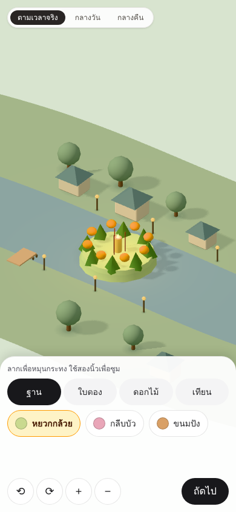 | 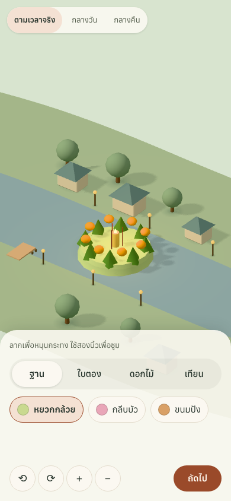 |
| Phone — wish | 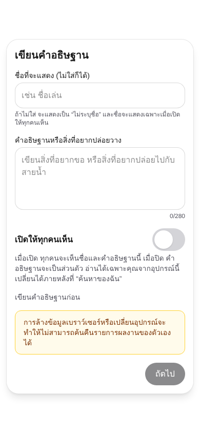 | 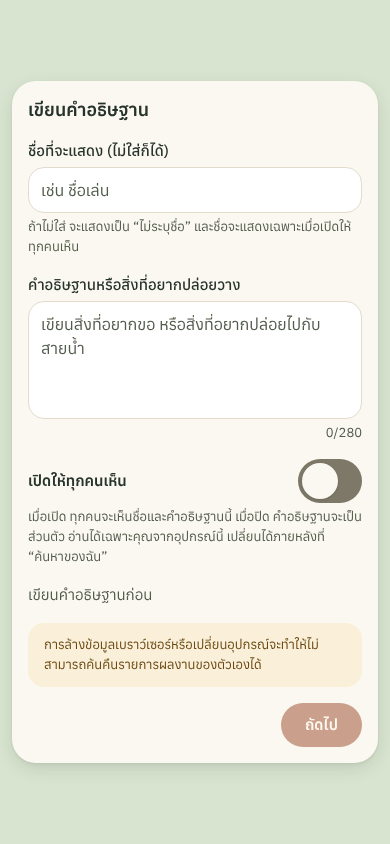 |
| Phone — release | 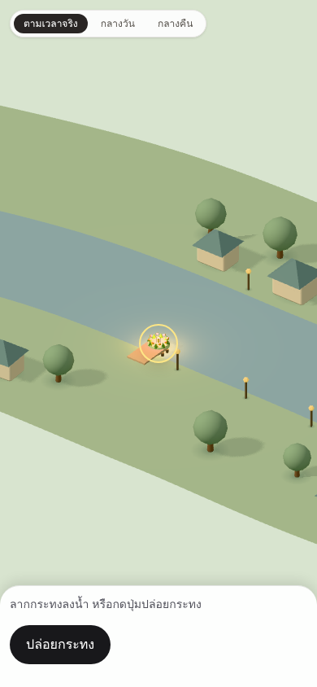 | 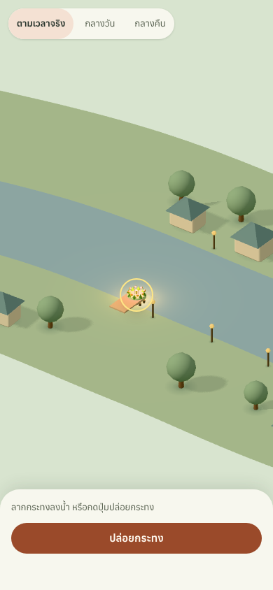 |
| Phone — world | 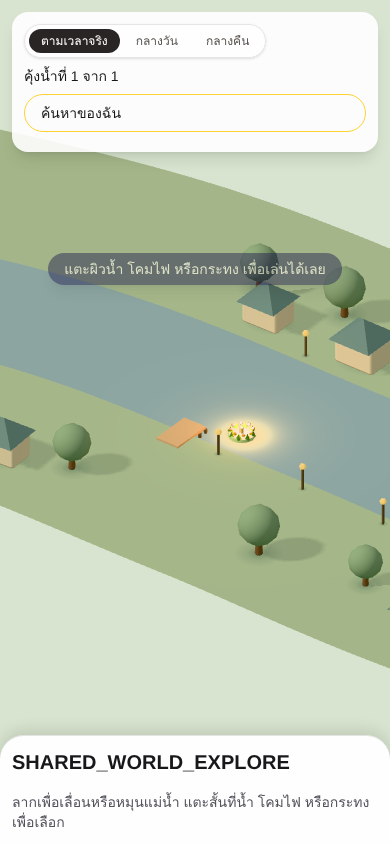 | 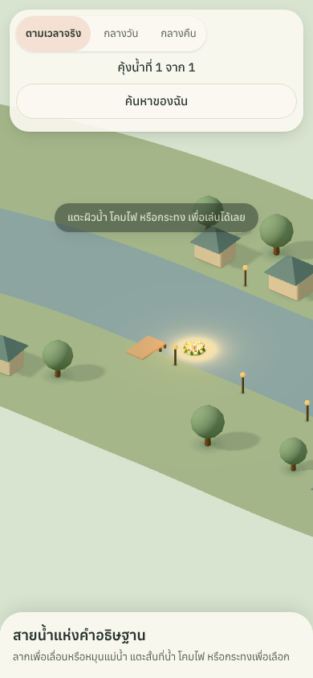 |
| Phone — My Creations | 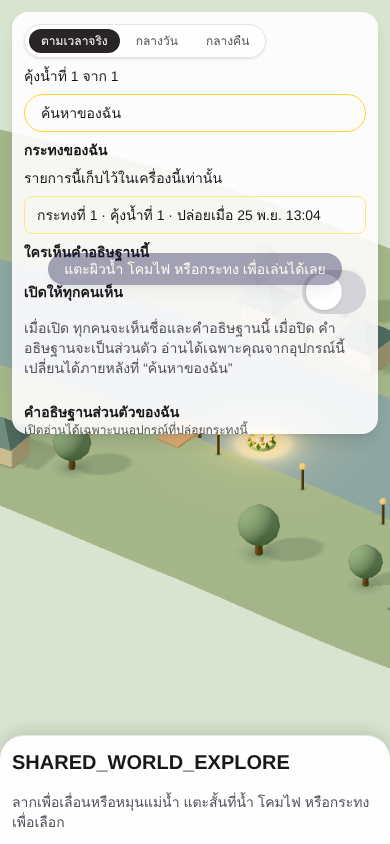 | 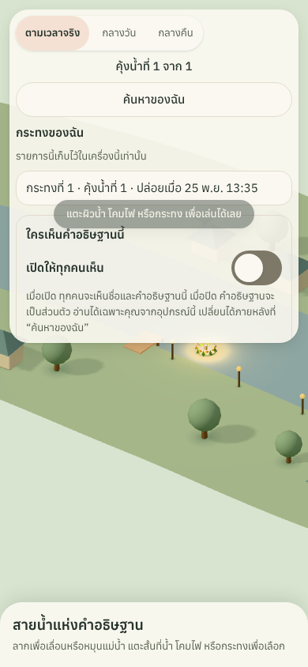 |
| Desktop — customize | 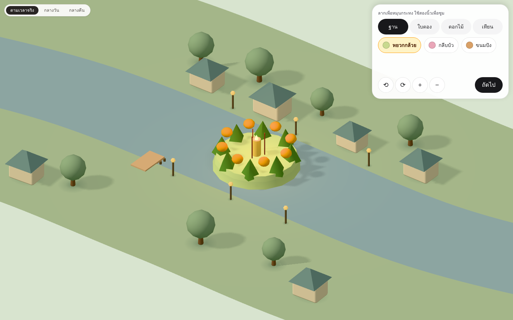 | 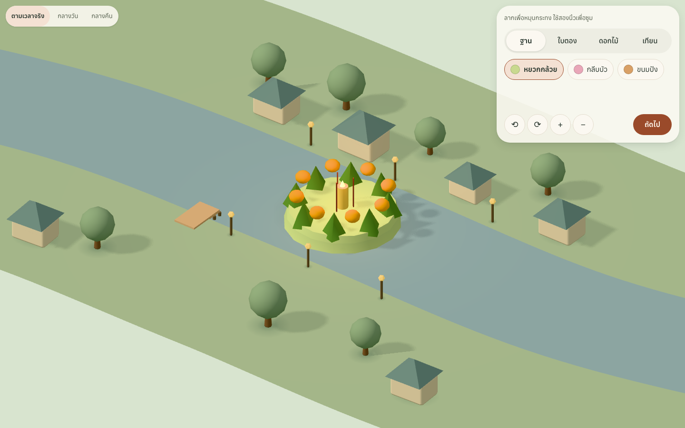 |
| Desktop — world | 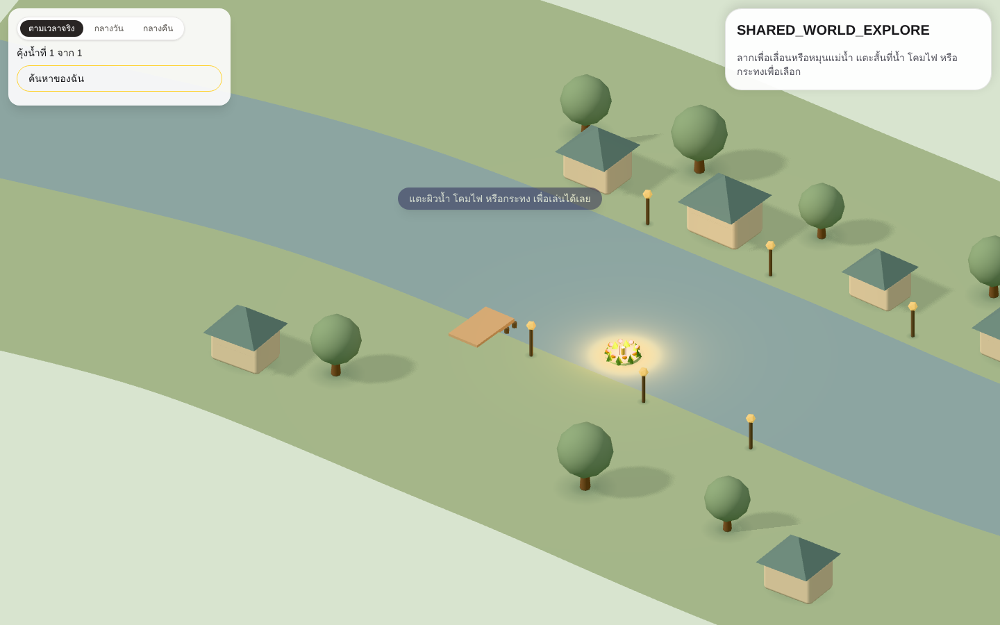 | 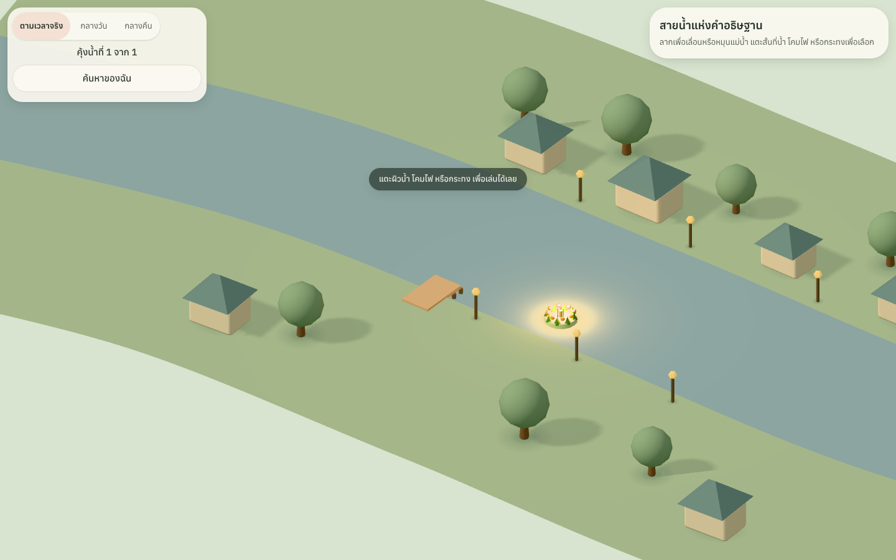 |
| Phone 2D — world | 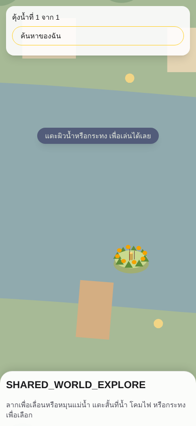 | 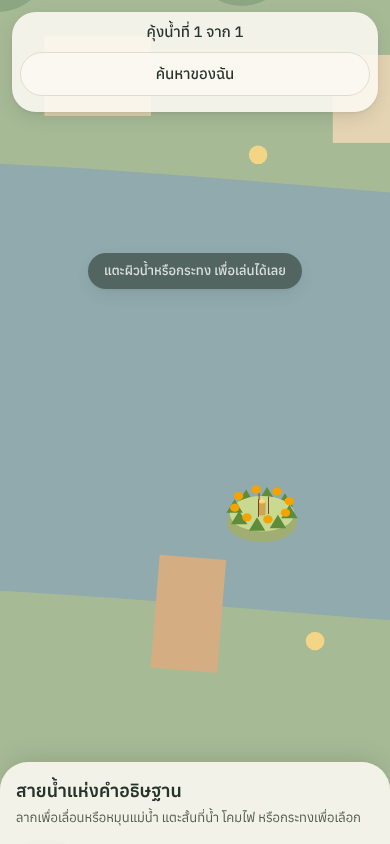 |
